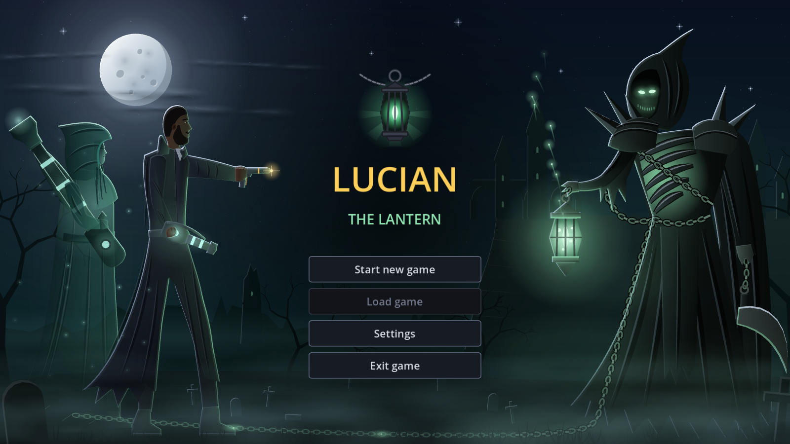
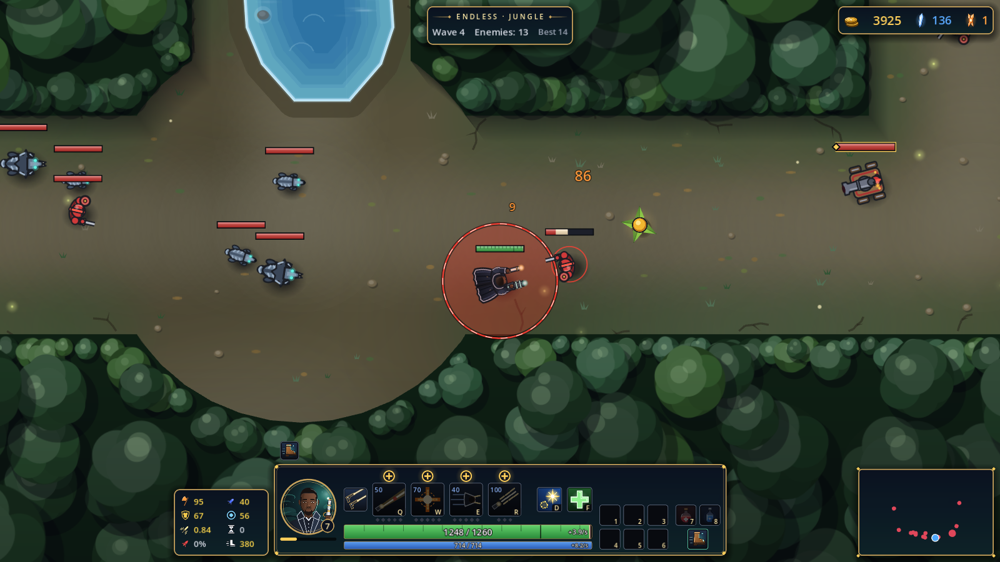
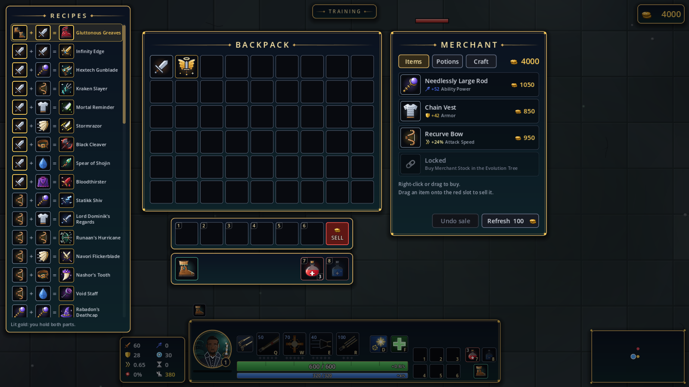
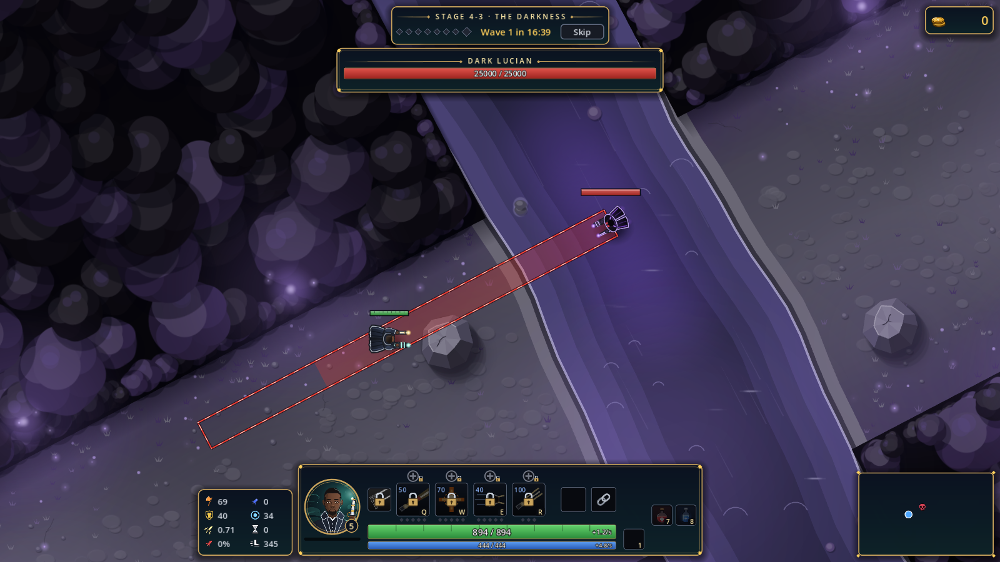
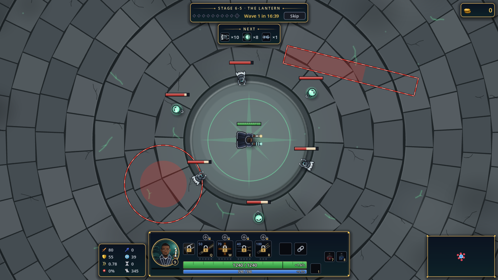
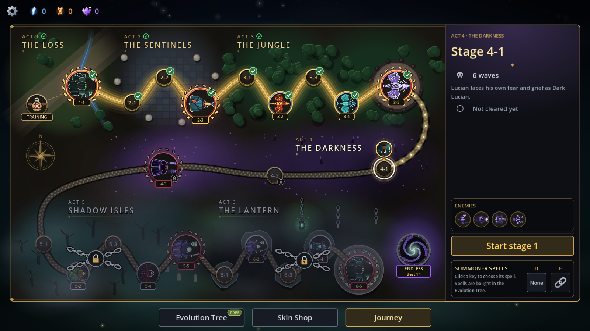
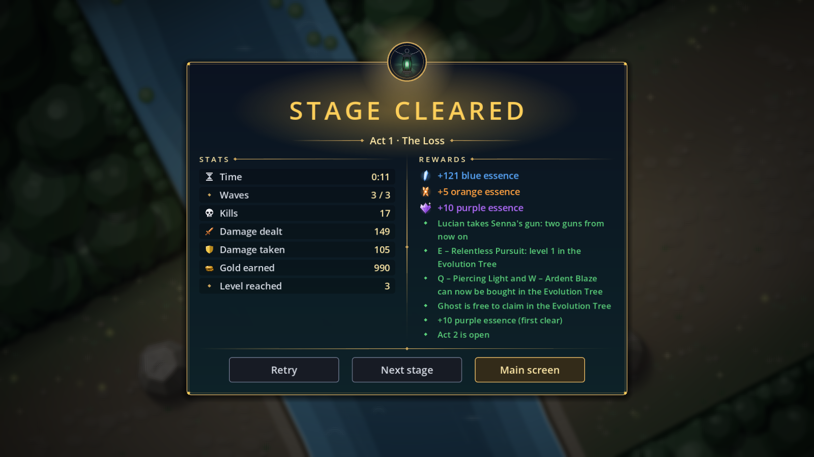
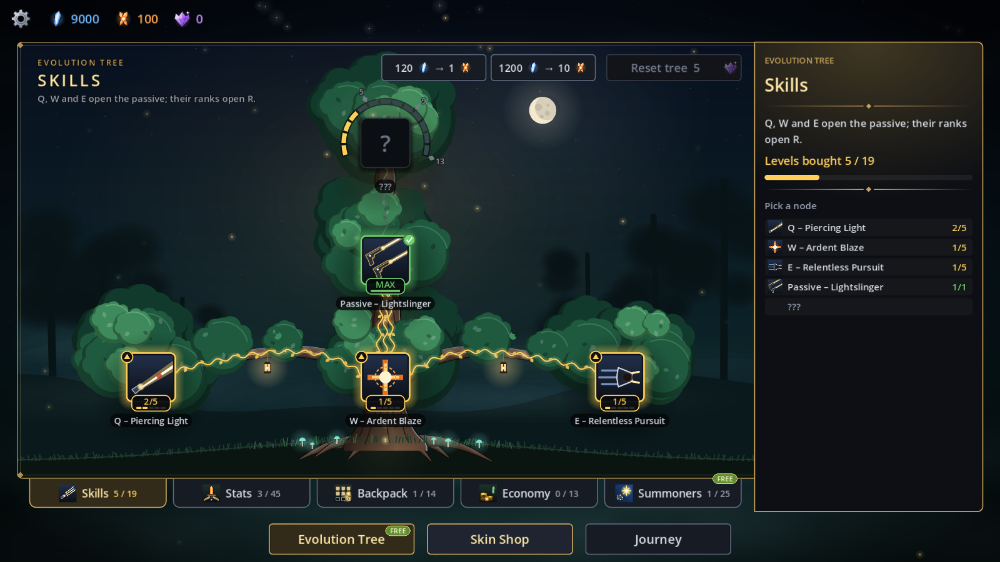
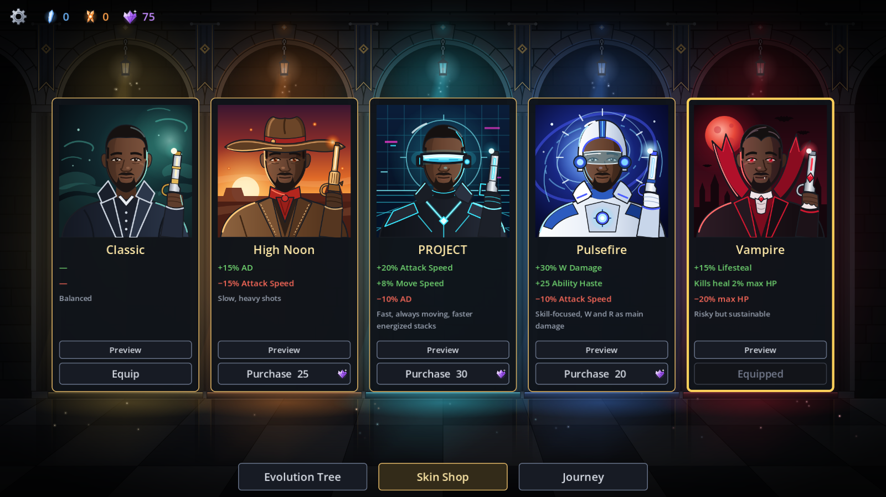

# Lucian: The Lantern

A free, top-down action game about Lucian, the Purifier. Thresh has taken Senna's soul into his lantern. Lucian fights through six acts, from the Sentinels' ruins to the Shadow Isles, to shoot through the lantern and set her free.

Made with Godot 4.7. A fan project, not affiliated with Riot Games (see [Legal](#legal)).



## Download and play

1. Open the [latest release](https://github.com/Anhdung1478/lucian-the-lantern/releases/latest).
2. Download `LucianTheLantern-v2.0.0-windows-x64.zip`.
3. Unzip it anywhere and run `LucianTheLantern.exe`.

- Needs Windows 10 or 11, 64-bit.
- The game is not code-signed, so Windows SmartScreen may warn the first time. Choose **More info → Run anyway**.
- Saves and settings live in `%APPDATA%\lucian_the_lantern`.

## The game

- **Story:** 22 stages in 6 acts, each with its own map, enemies and boss.

  | Act | Name | Boss |
  |---|---|---|
  | 1 | The Loss | Thresh (scripted) |
  | 2 | The Sentinels | Akshan |
  | 3 | The Jungle | Elder Dragon |
  | 4 | The Darkness | Dark Lucian |
  | 5 | Shadow Isles | Karthus |
  | 6 | The Lantern | Thresh, in two phases |

- **Lucian's kit:** Piercing Light (Q), Ardent Blaze (W), Relentless Pursuit (E), The Culling (R) and Lightslinger (passive). He fires his own pistol and Senna's relic gun in turn.
- **In a stage:** waves, a merchant between waves who sells items and crafts two fragments into a legendary for a fee, and level-ups that put skill points into ranks you bought.
- **Boots:** buy Boots of Speed or Slightly Magical Boots once in the Evolution Tree and start every map in them. Upgrade them at the merchant's Craft tab with a fragment and gold into 14 LoL boots, each with its own stats and passive.
- **Evolution Tree:** spend the essences you earn on skill ranks, stats, backpack and equip slots, a better economy, and summoner spells. The spells are Flash, Ghost, Barrier, Heal, Clarity and Smite. Its forge turns 120 blue essence into 1 orange, so spare blue is never stuck.
- **Skin Shop:** five skins, Classic, High Noon, PROJECT, Pulsefire and Vampire, each with its own strengths and weaknesses, and its own look and sounds for Q, W, E, R and basic attacks. Preview plays them in the shop.
- **Endless mode:** opens after Act 3. Waves keep getting stronger, with a mini boss every 5 waves, a boss every 10, and a modifier pick after each boss. Its enemies come from the acts you've cleared, and the first wins of waves 10, 20, 30 and 40 pay extra essence.
- **Difficulty:** Easy, Normal, Hard or Extreme, picked with a new game and fixed from then on (nothing in the game shows or changes it after that). It scales enemy HP and the damage Lucian takes (×0.8 to ×1.3), and Hard and Extreme pay more blue and orange essence.
- **Resolve:** each time a story stage beats you, it gets a little easier for your next try (up to 5 times, until you clear it): more damage dealt and less taken (10% a time on Easy and Normal, 5% on Hard, 3% on Extreme). It can be turned off in Settings → Gameplay.
- **The Lantern's gift:** halfway through each story stage of four or more waves, pick one of three boons that last until the stage ends (more attack damage, attack speed, haste, health, speed, omnivamp, armor or gold).
- **Elite traits:** from Act 3 on, and from wave 11 in Endless, each elite comes with one trait: Swift, Armored, Vampiric or Volatile. Its icon is over the health bar, and it pays 25% more gold and XP.
- **Between waves and after a defeat:** the break shows what the next wave brings, and a defeat shows what hit you most, with a tip.
- **Look:** from V2.0 the HUD, the backpack, the merchant, the end screens and every map were redrawn in the same look as the title: navy and gold, with the lantern's teal light, soft shadows and small effects (the effects are off on Low quality). The title picture, the Journey map, every enemy and boss, Lucian and his five skins, every item icon and every stat icon were drawn again too, and the Classic skin has its own skill effects.
- **Music:** a score made in code, one piece per act, that follows the fight: its drums grow with the enemies left, and a boss brings its own layer.
- **Other:** three save slots, rebindable keys, and three cast modes for each key.

| | |
|---|---|
|  |  |
|  |  |
|  |  |
|  |  |

## Controls

Every key can be changed in **Settings → Controls**.

| Action | Default |
|---|---|
| Move | Right mouse button |
| Attack | Left mouse button |
| Attack-move | A |
| Skills | Q, W, E, R |
| Summoner spells | D, F |
| Item slots | 1–6 |
| Health / Mana potion | 7 / 8 |
| Backpack | P |
| Stats panel | C (Ctrl + C toggles, hold for more) |
| Camera mode | Y |
| Center camera on Lucian | Space |
| Menu | Esc |

## Run from source

1. Install [Godot 4.7.2](https://godotengine.org/download) (standard, not .NET).
2. Open `project.godot` in Godot and press **F5**. The game is GDScript only, so it needs no build step.

**Tests** use [GUT](https://github.com/bitwes/Gut) (in `addons/gut`):

```powershell
godot --headless --path . -s res://addons/gut/gut_cmdln.gd
```

**Windows build:** install the Godot 4.7.2 export templates, then run:

```powershell
godot --headless --path . --export-release "Windows Desktop" build/windows/LucianTheLantern.exe
```

## Project layout

| Folder | What is in it |
|---|---|
| `src/` | Game code: core rules, Lucian, enemies and bosses, stages, UI |
| `data/` | Resources: enemies, items, skins, Evolution Tree nodes, waves |
| `assets/` | SVG art |
| `tests/` | Unit tests and the screenshot tool |
| `docs/` | Design docs, per-phase plans and reports with screenshots |

## Legal

Lucian: The Lantern isn't endorsed by Riot Games and doesn't reflect the views or opinions of Riot Games or anyone officially involved in producing or managing Riot Games properties. Riot Games, and all associated properties are trademarks or registered trademarks of Riot Games, Inc.

- **Free:** this is a non-commercial fan game. It is not for sale.
- **No license (all rights reserved):** you may download and play it, and read the source here. No permission is given to copy, modify or redistribute the code or art. The League of Legends characters, names and story belong to Riot Games.
