# Phase 3 report: gold, potions, merchant and shop, settings, item passives

**Date:** 2026-10-28 · **Branch:** `main` (11 commits from `1c01b73` to this report, not pushed) · **Plan:** `docs/implementation/phase3.md`

## Summary

Everything on the Phase 3 list is built and checked:
- stage gold
- HP and MP potions
- the merchant with his shop: buy, sell, refresh and a Potions tab
- debug buttons
- the Settings screen: sound, controls, graphics, and the skill queue
- item passives, with buff icons

The test suite grew from **192 to 320 tests**, and all of them pass. Every new screen and effect was checked in screenshots from a real game window. A separate code review found 4 bugs, and all 4 are fixed (see *Review*).

Your choices during planning:
- **Passives:** all on-hit, stacking and stat passives, from equipped items only.
- **Shop:** right-click the merchant to open it; buy by drag or right-click.
- **Other:** a Potions tab, key rebinding only, placeholder sound effects, and all 3 item actives.

## What you asked for → what was built

| Request | Built |
|---|---|
| HP and MP potions | **Health Potion** (200 HP over 5 s) and **Mana Potion** (150 mana over 5 s), 50 gold each, stacking 9 per cell. Drink by right-click → **Use** in the backpack, or press 1–6 when one is in an equip slot. Nothing is restored while the game is paused. Spirit Visage boosts the healing. |
| Merchant in the center of the training map | He stands at the map center, (2400, 1350). The dummy moved north to (2400, 950). Right-click him: Lucian walks over and the shop opens within 250 units. A gold ring shows on hover, and he blocks movement. |
| Shop UI: refresh, buy and sell, buy HP/MP potions | The backpack opens on the left and the **MERCHANT** panel on the right, with the gold amount. The **Items** tab has 4 slots, 2 unlocked, with chains on the rest; each slot holds a fragment, or a legendary at 10%. The **Potions** tab is unlimited. Buy by right-click (first fitting cell) or by dragging onto a cell. The red **SELL** slot pays 70% (Guardian Angel 40%) and shows the price while you drag over it. **Refresh** costs 100 and keeps bought slots on **SOLD**. A refused purchase shows a red message and makes a sound. ESC or P closes the shop. |
| Debug: add or remove the merchant | Debug → **Shop** tab: Add merchant (a new visit with new stock), Remove merchant (closes his shop), Shop item slots 1–4. |
| Debug: add HP/MP potions | Debug → **Items** tab: **+HP potion** and **+MP potion**. The item picker lists the potions too. |
| Settings screen | ESC → **Settings**, with 4 tabs. Every change applies at once and is saved to `user://settings.json`. <ul><li>**Audio:** Master, Music and SFX sliders.</li><li>**Controls:** rebind every action to a key or mouse button. A key already in use swaps the two actions, and Reset puts everything back. The HUD key labels follow.</li><li>**Graphics:** window mode, VSync, FPS cap, Quality (Low / Medium / High) and Show FPS.</li><li>**Gameplay:** the skill queue, moved here from the debug table.</li></ul> |
| Stage gold, debug gold, gold UI | A `Wallet` per stage, starting at 0. The coin and amount show at the top right, and again in the shop. Debug → Shop: +100 / +1000 / +10000 / Reset. |
| Kraken Slayer buff icon | Every 3rd basic attack deals +140 physical, more against low-health enemies. Its icon above the portrait shows the hit count and glows before the 3rd hit. |
| Energized buff icon | Shown only while Statikk Shiv, Rapid Firecannon or Stormrazor is equipped. It counts from 0 to 100 and glows at 100; the next attack is then Energized and it starts over. **Attacks add 10, walking adds 1 per 24 units, and dashes count double.** Each item fires its own effect: Statikk's chain lightning to 5 enemies, RFC's +60 magic and +35% range, Stormrazor's +90 magic and +35% move speed. |
| (planning) all on-hit / stacking passives | 23 legendaries' passives and 3 actives work in combat. The full list is in `docs/items.md` → *What works in combat*. Buff icons show potions, move speed, the Bloodthirster shield, Spellblade, Shojin, Jak'Sho and Archangel. Tiny icons above the dummy's HP bar show Carve, Grievous Wounds, slow and Hatefog. |
| (planning) actives on keys 1–6 | Hextech Gunblade, Galeforce and Hextech Rocketbelt. Copies share one cooldown, which keeps running after you sell the item, and the cooldown shows on the HUD slot. |
| (planning) sound | Master, Music and SFX audio buses. 8 placeholder sounds are generated in code: shot, hit, coin, error, potion, craft, refresh and zap. There is no music yet. |

## Choices I made where the request was open

- **The energize charge does not fill when standing still.** I read "run from 1 to 100 … run and dash make the energized fulfil faster" as: the charge counts up to 100, and attacks and movement fill it, with dashes counting double. If you meant a slow fill over time even while standing still, it is one line in `src/core/energize_charge.gd`.
- **"Backpack has the item" means equipped.** This follows your answer, and it is the same rule as item stats.
- **Defensive passives stay as tooltip text** because nothing hits Lucian yet: Banshee's, Thornmail, Shieldbow, Death's Dance, Fimbulwinter's shield, Guardian Angel, Kaenic Rookern.
- **Placeholder numbers I picked:**
  - potion prices, amounts and restore times
  - refresh cost 100, legendary chance 10%
  - the Kraken low-HP scaling, the Lord Dominik's HP gap and Jak'Sho's "in combat" (dealt damage in the last 3 s)
  - Hatefog: radius 150, once per 3 s
  - Runaan's range 450, Statikk's jump 500, and the dash lengths of the actives

  They are all constants at the top of their files and listed in `phase3.md`.
- **The debug table is now in tabs** (Lucian / Items / Shop / Dummy). With the new sections it no longer fit on screen.

## Verification

- **Unit and scene tests (GUT):** **320 of 320 pass**, up from 192 before Phase 3.
  - New test files: `test_wallet`, `test_restore_over_time`, `test_potions`, `test_merchant_stock`, `test_shop`, `test_shop_drag`, `test_game_settings`, `test_energize`, `test_item_passives` (31 cases), `test_item_actives`.
  - New cases were added to `test_inventory`, `test_backpack_drag`, `test_item_data_files` and `test_tooltips`.
- **Screenshot runs in a real window:**
  - New scenarios: `gold`, `potions`, `shop`, `settings`, `buffs`, `actives`, `energized`. Each prints its expected and actual values, and every check matched.
  - Earlier scenarios rerun without regressions: `attack`, `menu`, `tooltip`, `backpack`, `craft`, `hud_items`, `combo`, `icons`.
- **Review:** a separate reviewer read the whole Phase 3 diff and found 4 bugs, all now fixed and covered where they can be tested:
  - The debug table's dock-right signal was only connected on the first shop visit.
  - A mouse click while rebinding (e.g. on a tab) became the new binding.
  - Hatefog ticked 4 times instead of 3.
  - Spear of Shojin's and Archangel's Staff's "first skill hit" arming survived unequipping mid-cast.
- **Tests no longer read your settings:** they run against a scratch settings file, so your own `user://settings.json` can't change their results.

### Screenshots

| | |
|---|---|
| 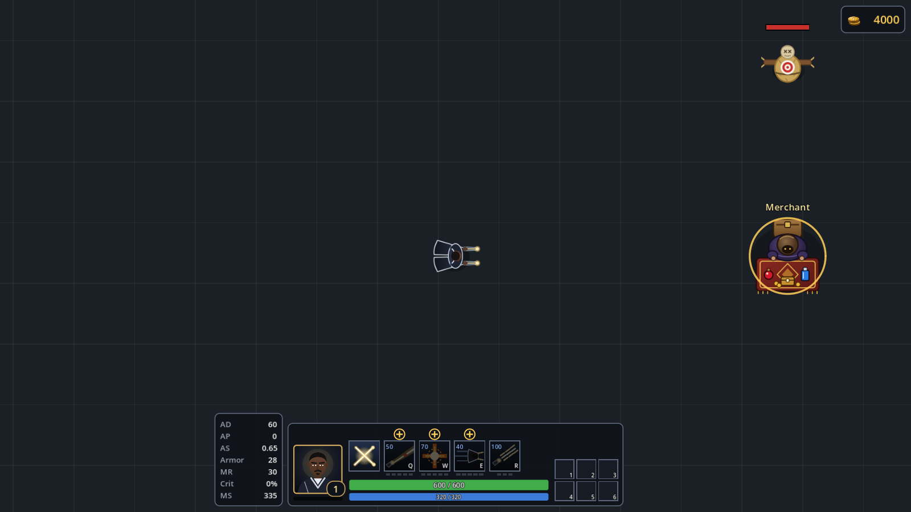 Merchant at the map center, gold ring on hover | 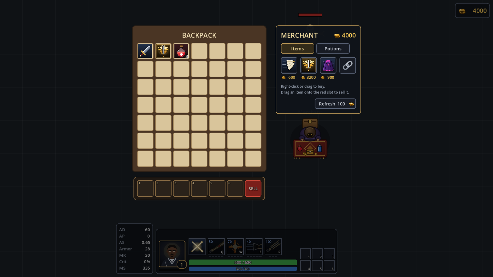 Shop beside the backpack, chained 4th slot, red SELL slot |
| 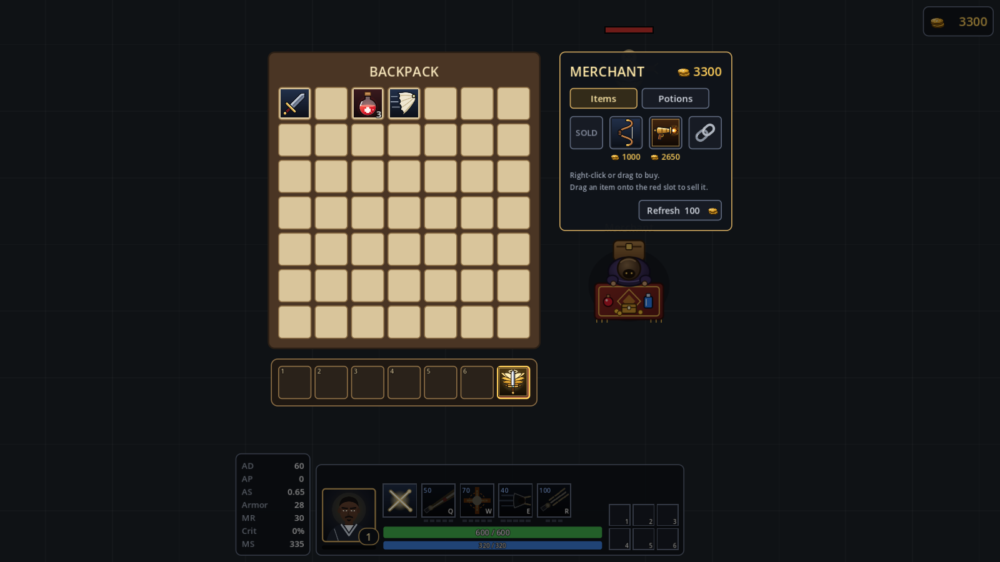 Bought slot shows SOLD; dragging a Guardian Angel over the SELL slot | 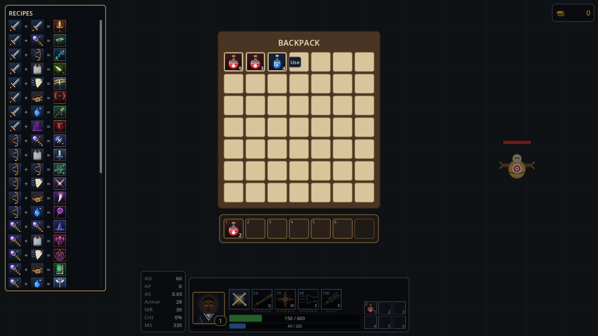 Potion stacks and the right-click Use button |
| 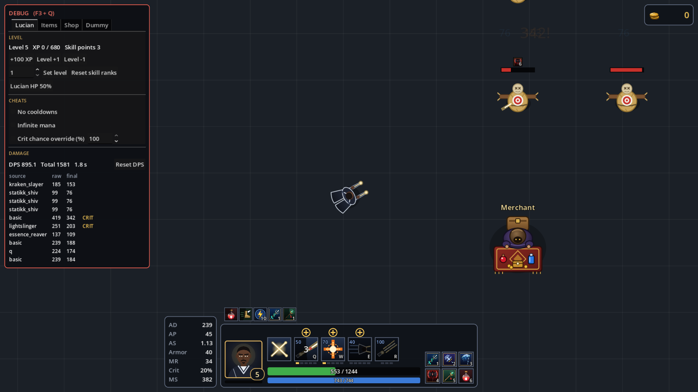 Buff icons above the portrait; Carve ×6 on the dummy; Statikk chain and Kraken hits in the log | 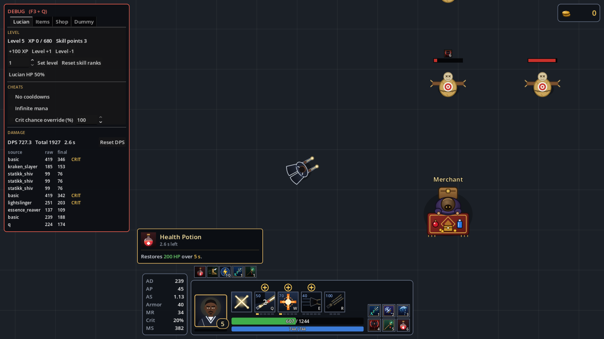 Hovering a buff icon |
| 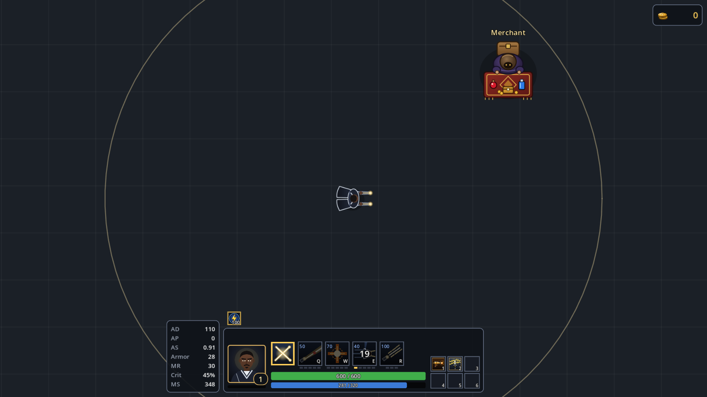 Energized at 100 (gold frame); RFC's longer range ring | 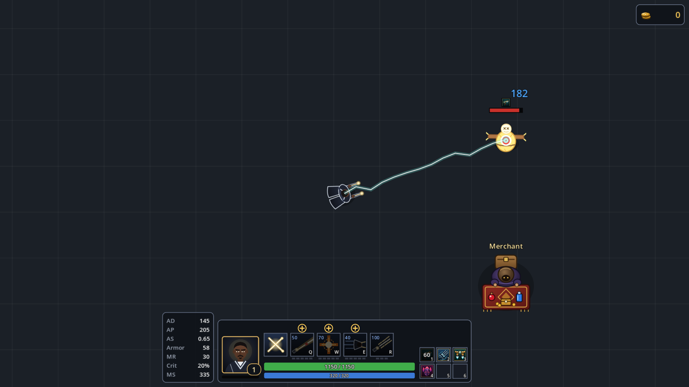 Gunblade bolt, slow icon, 60 s cooldown on slot 1 |
| 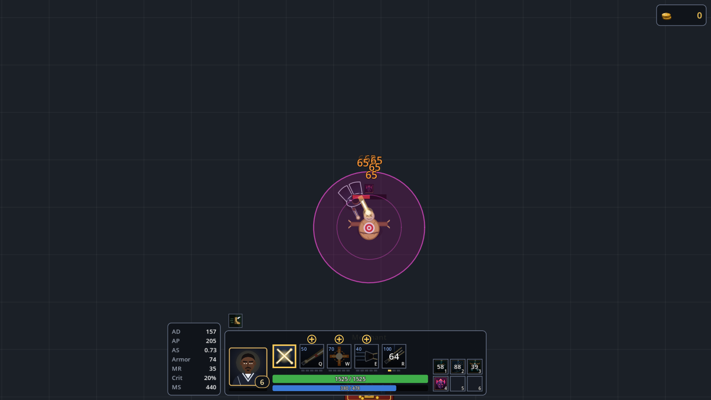 Malignance Hatefog under R | 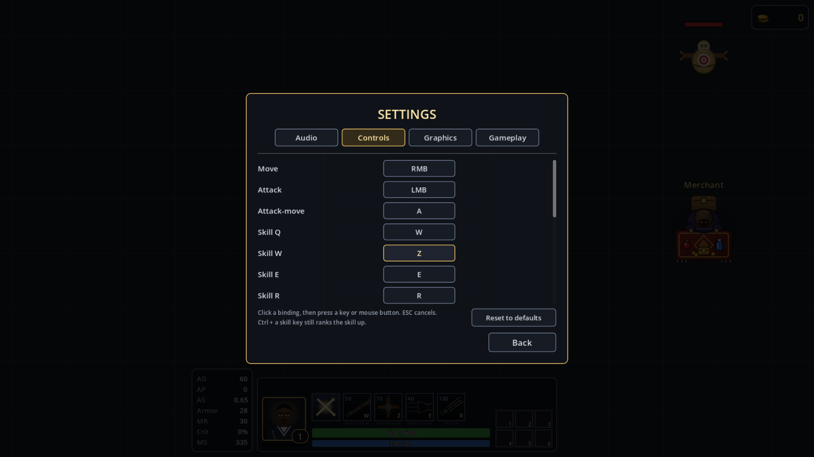 Rebinding with a swap (Q→W, W→Z) |
| 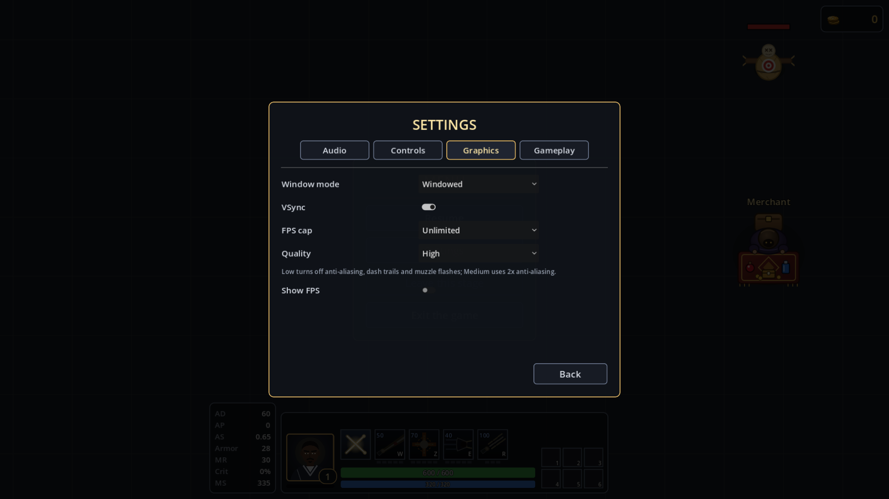 Graphics tab | 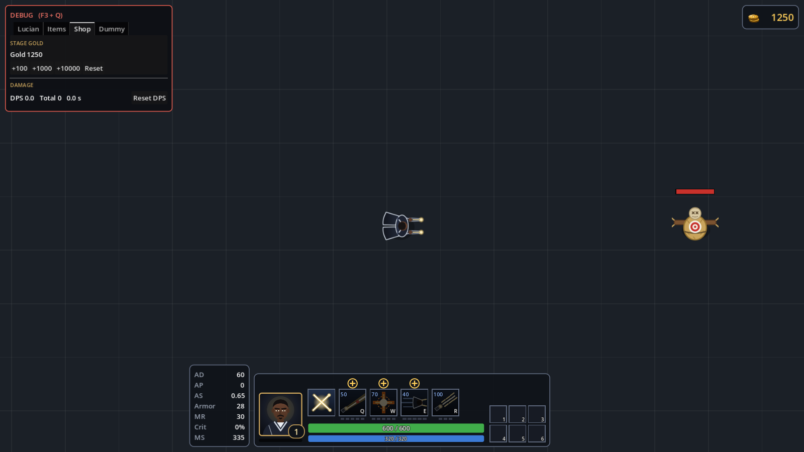 Gold top right, debug Shop tab |

## Known limits

- **Gold only comes from the debug table.** Nothing dies yet, and there are no waves.
  - The merchant is therefore always present. The design's "only during the 20 s break" waits for waves.
- **No cast modes** (normal / quick with indicator), as agreed; skills stay quick cast.
- **No music track.** The Music slider controls an empty bus.
- **Sounds are synthesized placeholders.** Shots and hits are throttled so R doesn't overload the audio.
- **Kraken Slayer's count never expires.** A Kraken or Spellblade hit already in flight when you unequip still lands, because it was earned while the item was equipped.
- **Grievous Wounds only shows an icon**, since no enemy heals yet. The dummy's refill after 4 s is a reset, not healing.
- **"Leave this stage"** in the ESC menu is still disabled; it needs stage select.

## Manual playtest checklist (for you)

1. F3+Q → Shop tab → +1000 gold. The top-right number updates.
2. Right-click the merchant from far away. Lucian walks over, the shop opens, and the game pauses.
3. Buy by right-click and by dragging onto an equip slot. Try one you can't afford, and drop one onto a taken cell.
4. Drag an item onto the red SELL slot and read the sell price. Refresh and check that SOLD stays.
5. On the Potions tab, buy several and watch them stack to 9. Drink one from the backpack (Use) and see that healing starts after you close it. Put one in slot 1 and press 1.
6. Equip Kraken Slayer and Statikk Shiv, then set Dummy count 3 in the Dummy tab.
   - Watch the Kraken count reach 3.
   - Watch the Energized number climb faster while you run and press E.
   - At 100 it glows, and the next hit chains lightning.
7. ESC → Settings. Rebind Q, check the HUD label changes, restart the game, and confirm the binding was kept. Move the SFX slider and listen.
8. Set Quality to Low and confirm the E dash trail and muzzle flashes are gone.

## Feedback and suggestions

- **The biggest gap is a reason to earn gold.** The economy can't be balanced until enemies die. Waves, killable enemies, gold and XP drops, the break timer and Skip are the natural Phase 4, and they would also bring the merchant's real "between waves" timing.
- **Balance watch:** Archangel's mana charge, Muramana's Shock on each of R's 22 bullets, and Runaan's crit bolts may be strong once real enemies exist. All their numbers are constants and easy to tune.
- **Hit log names:** the debug log shows item ids (`kraken_slayer`). If you want display names there, it is a small change.
- **Merchant art and the sounds** are placeholders made in code; real assets can replace them file by file.
- **One request to double-check:** confirm the energize interpretation above. It is the only point where I wasn't sure what you meant.
