# Phase 4 report: fixes, UI polish and summoner spells

**Date:** 2026-10-28 · **Branch:** `main` (commits from `9b5b07c` to this report, not pushed) · **Plan:** `docs/implementation/phase4.md`

## Summary

All 16 points on your Phase 4 list are built and checked:
- the four fixes: Energize, debug item order, Rocketbelt range, No cooldowns
- the skill bar: grey "+", greyed skills during R and Q, a smaller passive with new art
- Space to recenter the camera
- stat icons and colors, the new stats panels and hover cards
- the Rapid Firecannon range ring
- all six summoner spells
- the Resolution setting

The test suite grew from **320 to 359 tests**, and all of them pass. Every new screen and effect was checked in screenshots from a real game window. A separate code review found 2 problems with the Resolution setting and a few smaller ones; all are fixed (see *Review*).

Your choices during planning:
- **Passive icon:** 70% of a skill icon (45 px).
- **Summoner spells:** picked for D and F in the debug table (default Flash and Heal) until the Evolution Tree exists.
- **Energize:** +9 per basic attack.
- **Grey "+":** only while there is a skill point to spend; locked when the rank isn't bought.

## What you asked for → what was built

| # | Request | Built |
|---|---|---|
| 1 | Energized stack after each attack (~9) | Each basic attack adds **9** (was 10). Walking still adds 1 per 24 units and dashes count double. |
| 2 | Debug items sorted by name | The debug Items picker lists every item **A → Z** (case ignored). |
| 3 | Rocketbelt bolts reach ~900 | The arc of 7 bolts flies **900** from where Lucian started the dash (was 500). |
| 4 | No cooldowns doesn't reset running item cooldowns | Ticking **No cooldowns** now also clears running **item** and **summoner** cooldowns, like skills. Spellblade's 1.5 s also skips its cooldown under the cheat. |
| 5 | Grey "+" when a skill can't rank up | While you have a skill point, every unmaxed skill shows its "+": **gold** when it can rank up, **grey** when it can't yet, **grey with a small lock** when that rank isn't bought. Grey ones can't be clicked. |
| 6 | Rank 2/3/4/5 not at level 2/4/6/8 | This rule was already in place (rank *r* needs level 2*r* − 1, like LoL). Phase 4 adds a test for every rank, and the grey "+" now shows it. |
| 7 | Space returns the camera to Lucian | **Space** (new action "Center camera on Lucian", rebindable) moves the camera back over Lucian once. Free-cam stays free. |
| 8 | Stat icons and colors | 19 hand-drawn stat icons (`assets/art/stats/`), with your 8 designs and colors for the main stats. The stats panel shows **icon + amount**. Item cards show **icon → amount (in the stat color) → name**. AP scalings in skill tooltips are now blue to match. |
| 9 | Stat description on hover | Hover a stat for **1 s**: a card with its icon, name, current value and what it does. |
| 10 | Ctrl + C toggles, hold C for extra stats | **Ctrl + C** shows or hides the main table: AD, AP, Armor, MR, AS, Ability Haste, Crit, MS, two per row like your image. **Holding C** shows the extra table above it: health / mana regen (one cell, per second), heal & shield power, armor / magic pen, life steal, omnivamp, attack range, tenacity. |
| 11 | RFC range ring while Energized | With Rapid Firecannon equipped and the charge at 100, a **light-blue ring** shows its longer reach (675). It disappears when the Energized shot lands (or after 1 s if the target vanishes). |
| 12 | Summoner spells | **Flash, Ghost, Barrier, Heal, Clarity, Smite** on D and F, each with its own icon, cooldown sweep on the HUD and hover card. Numbers are in the table below. |
| 13 | Smaller passive icon | The passive is **45 px** (70% of a skill icon), centered on the skill row. |
| 14 | New passive icon | Two relic pistols side by side, each firing a ray of light. |
| 15 | Grey Q/W during R, E during Q | While R fires, learned **Q and W turn grey**; during Q's 0.3 s cast, **E turns grey**. They are desaturated, not just darkened. |
| 16 | Resolution in Settings → Graphics | **Resolution**: 1280×720 up to 3840×2160. It sizes and centers the window in windowed mode, title bar included, and is saved. Sizes too big for a window on your screen are greyed out and marked "too big". The whole option is greyed out in borderless/fullscreen. |

### Summoner spells (placeholder numbers)

| Spell | Cooldown | Effect |
|---|---|---|
| Flash | 90 s | Blink up to 400 toward the cursor. If that spot is inside a wall or an enemy, it lands just short of it. |
| Ghost | 60 s | +40% move speed and pass through enemies for 6 s. |
| Barrier | 60 s | Shield of 95 + 18 × level for 2.5 s, stronger with heal & shield power (white on the HP bar, plus a buff icon). |
| Heal | 60 s | Heals 80 + 15 × level (heal & shield power applies), +30% move speed fading over 1 s. |
| Clarity | 45 s | Restores 50% of max mana. |
| Smite | 30 s | 450 true damage to the enemy nearest the cursor within 500, and heals 10% of max HP. Refused, at no cost, with no enemy in reach. |

Each spell keeps its own cooldown, also when you move it to the other key. Ability haste doesn't shorten them. Pick the spells in F3+Q → **Lucian** tab → *Summoner spells*; choosing the spell the other key has swaps them.

## Follow-up after your first playtest

| You asked | Built |
|---|---|
| Can't move during Rocketbelt; don't dash faster than the rocket | The dash is slower than the bolts, so they fly ahead. Then, from your second round of feedback: dash speed −20% (800), and Lucian can move as soon as the dash lands. |
| Can't move during Galeforce | Dash speed −10% (1260), and Lucian can move as soon as the dash lands. |
| Galeforce missiles should follow a missile trajectory | The 3 missiles leave in a fan, then curve onto the chosen enemy, faster and tighter as they fly, with a trail. |
| Remove Rocketbelt's move speed | Gone. |
| HP bar for Lucian; regen per second on the bars | A green HP bar above Lucian's head (shields in white). The HUD's HP and mana bars show "+0.8/s" and "+1.6/s" at the right end. |
| One regen stat in the extra table | One cell with a heart-and-droplet icon: "0.8 / 1.6" (health / mana per second). The extra table is now 2 × 4. |
| Stats with a bonus in yellow; base + bonus on hover | A number turns yellow when items, passives, buffs or cheats add to what the level alone gives. Its hover card shows "60 base + 22 bonus" with the bonus in yellow. |
| Redraw the Flash and Barrier icons | Flash: a burst of light where it lands and a ring of yellow sparks where it left. Barrier: a gold figure inside a golden bubble. |
| Every dash shows a trail; Flash only marks where Lucian was | E (light blue), Galeforce (pale green) and Rocketbelt (violet) leave a trail that grows behind Lucian from the start of the dash and fades once it lands. Flash leaves none: yellow sparks ring the spot Lucian left, drift out and fade in 0.6 s. |
| A move clicked before a dash should be ignored | It was already dropped for a quick click, but with right-click still held, Lucian kept following the cursor after the dash. Now any dash drops the move (and a merchant visit) from before it, even while the button is held. Right-click again, during the dash or after it, to walk on. Attacks still carry on. |

## Choices I made where the request was open

- **Icons for the other stats** (health, mana, regen, heal & shield power, penetration, life steal, omnivamp, range, tenacity): my own designs and colors, listed in `ui_design.md` → *Stats panel*.
- **Greyed skills only change their look.** Q and W were already refused during R. E pressed during Q is still queued (with the skill queue on) and fires when Q ends.
- **Flash doesn't build Energize**, since it is a teleport rather than movement.
- **The RFC ring uses its own light-blue color**, so it doesn't look like the attack-move ring. When both apply, the attack-move ring wins.
- **Barrier stacks with Bloodthirster's shield** on the HP bar. Nothing hits Lucian yet, so both shields only show for now.

## Verification

- **Unit and scene tests (GUT):** **359 of 359 pass**, up from 320.
  - New test files: `test_stage_camera`, `test_stat_style`, `test_stats_panel`, `test_summoner_spells`.
  - New cases were added to `test_energize`, `test_item_catalog`, `test_item_actives`, `test_item_passives`, `test_champion_progress`, `test_lucian_casting`, `test_game_settings`, `test_item_stats`, `test_skill_slot` and `test_tooltips`.
- **Screenshot runs in a real window:**
  - New scenarios: `skillbar`, `stats`, `rfc_ring`, `summoners`, `camera`. Each prints its expected and actual values, and every check matched.
  - Earlier scenarios rerun: `hud`, `tooltip`, `buffs`, `energized`, `actives`, `settings`, `hud_items`. One check in `actives` had always printed a wrong result: it looked for Gunblade's 2 s slow 2.6 s after the hit. It now checks right after the hit, and passes.
- **Resolution in a real window:** on this 1920×1080 screen (1040 px usable), every size keeps the whole window, title bar included, on screen and centered. 1920×1080 and up are greyed out as "too big".
- **Review:** a separate reviewer read the whole Phase 4 diff. It found 2 important problems and some smaller ones. All are fixed and covered by tests where possible:
  - **Resolution could push the title bar off-screen.** Window sizes don't include the frame, so 1920×1080 on a 1080p screen (or the 1600×900 default on a smaller laptop) put the title bar above the screen. The window now fits with its frame and is centered with it.
  - **The Resolution list could show the wrong size, or nothing.** It used to hide sizes that didn't fit, so a saved size that didn't fit showed as another one. Now every size is listed and the ones that don't fit are greyed out.
  - **A new action could share a key with an older settings file.** Example: a Phase 3 file with Space on another action. A new action now only gets its default key if no saved action uses it; otherwise it starts unbound ("-"). Binding an unbound action takes the key away from its owner.
  - **Barrier now grows with heal & shield power**, like the Ichorshield.
  - **Flash's text** now says what it does: if the target spot is inside a wall or an enemy, Flash lands just short of it, so it can cross them.
  - **Tighter tests:**
    - Flash's exact landing spot next to an enemy (280).
    - Rocketbelt bolts stop at 900.
    - No summoner spells mid-dash.
    - The Barrier buff and card.
    - The gold, grey and locked "+" states.
    - Test effects are freed with the tests.
  - **Left as is:** Flash still uses its cooldown if the cursor is on Lucian, as in LoL. The debug picker's "D" / "F" labels don't follow rebinding.

### Screenshots

| | |
|---|---|
| 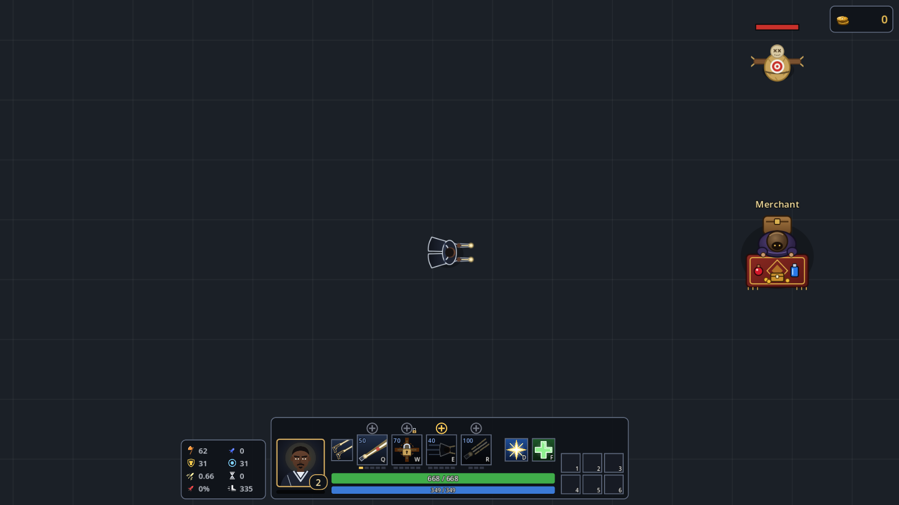 Level 2 with a point: gold + on E, grey on Q (needs level 3) and R, grey with a lock on W (rank not bought); 45 px passive | 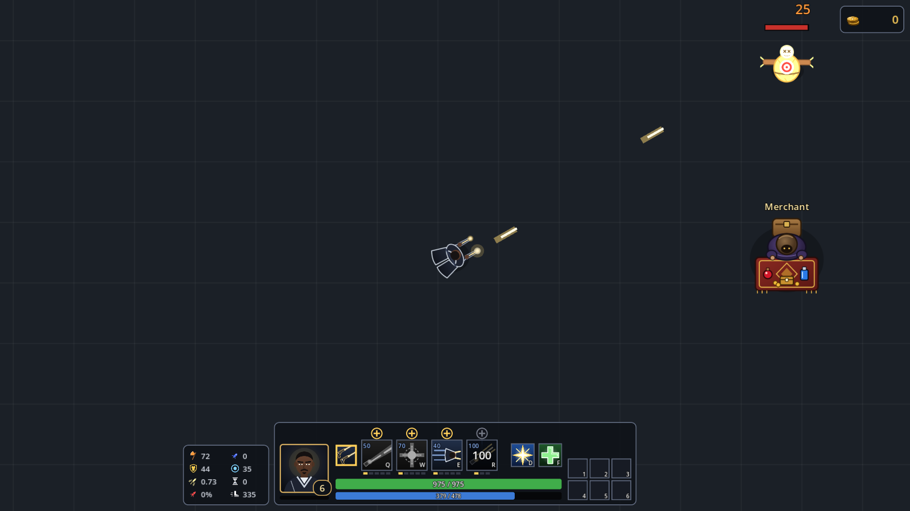 R firing: Q and W grey |
| 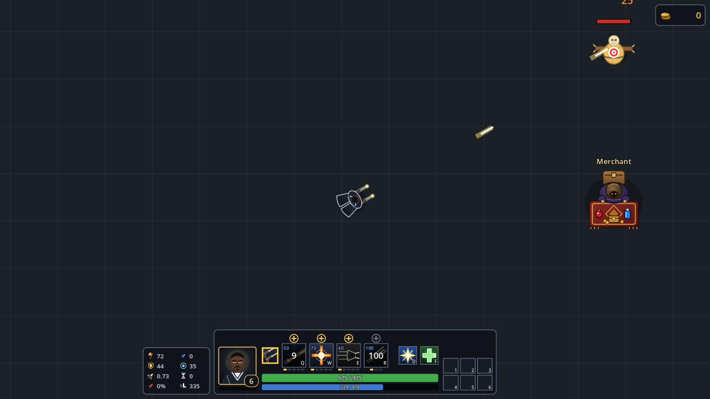 Q's cast time: E grey | 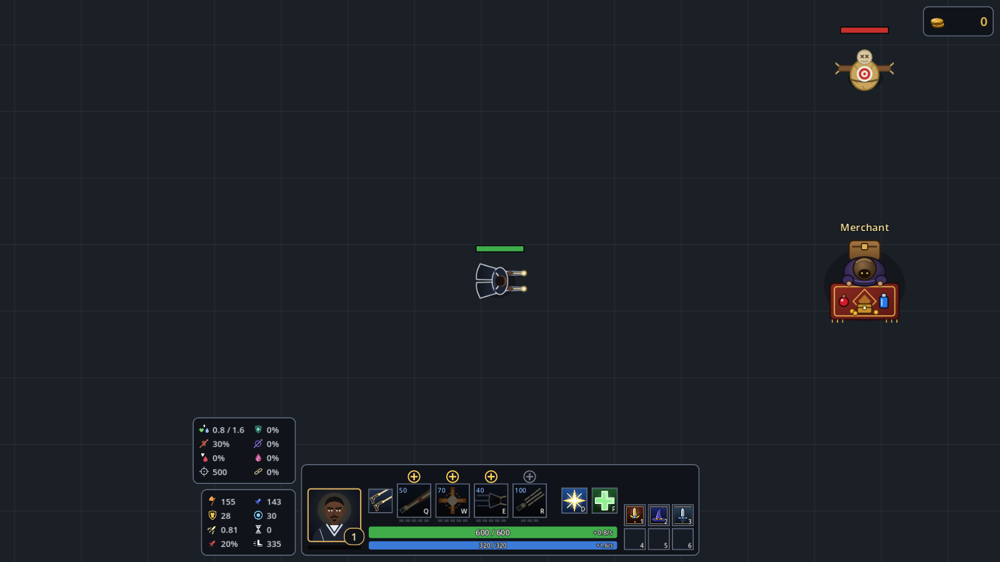 Holding C: the extra stats above the main table |
| 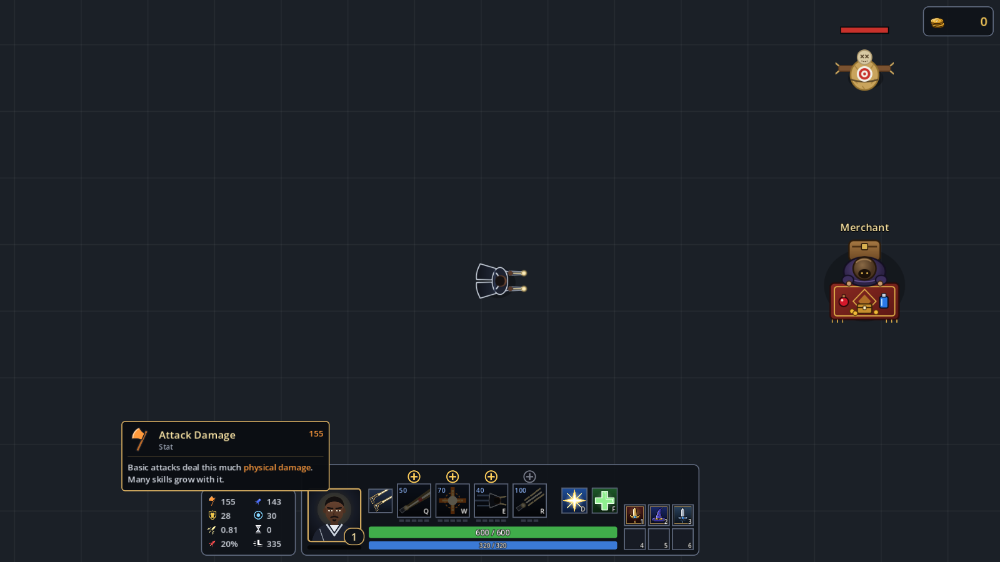 Hovering Attack Damage | 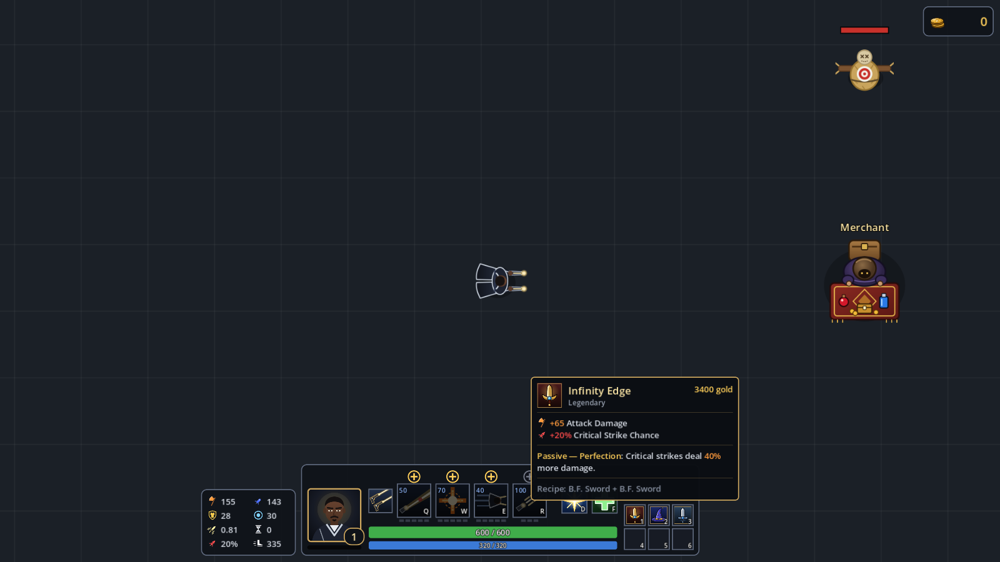 Item card: icon, amount, name |
| 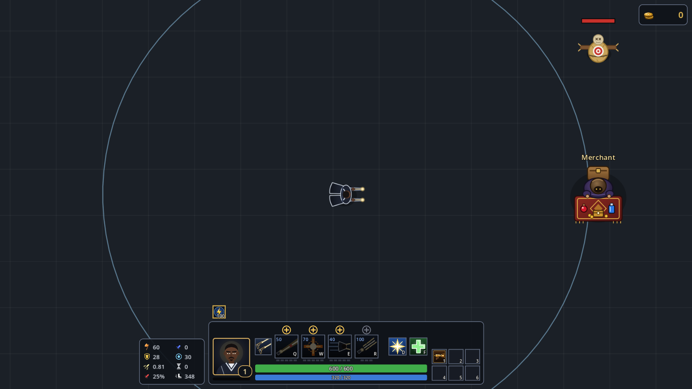 RFC at full charge: the 675 range ring | 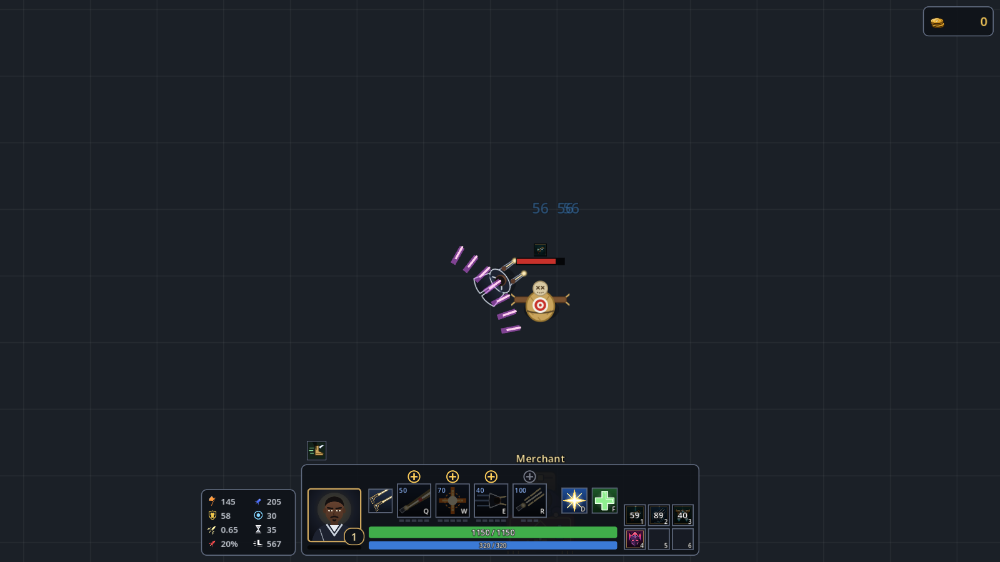 Rocketbelt arc, flying ahead of Lucian; mid-dash, its violet trail grows behind him |
| 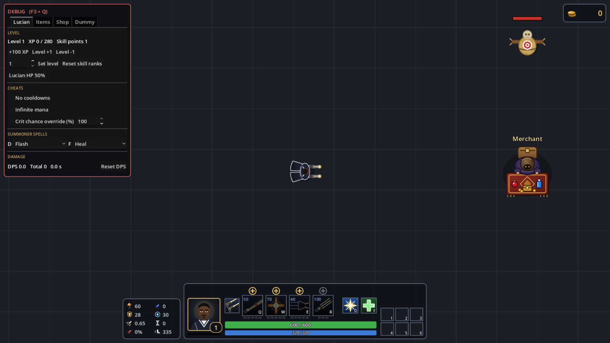 D/F on the HUD, debug picker | 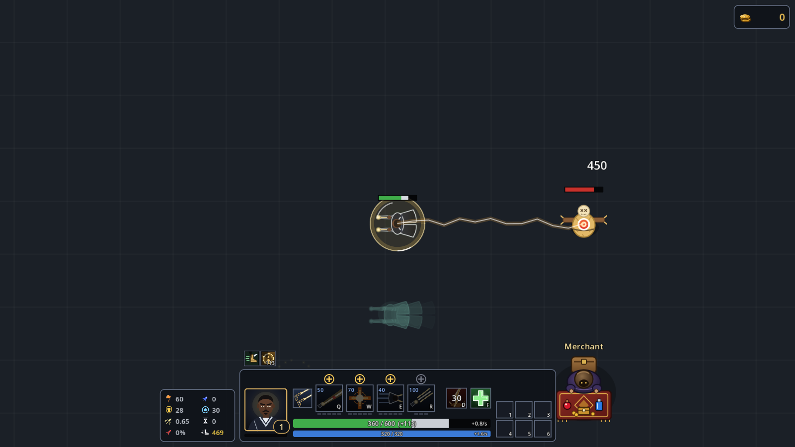 Smite: 450 true damage; Barrier on the HP bar, Ghost and Barrier buffs |
| 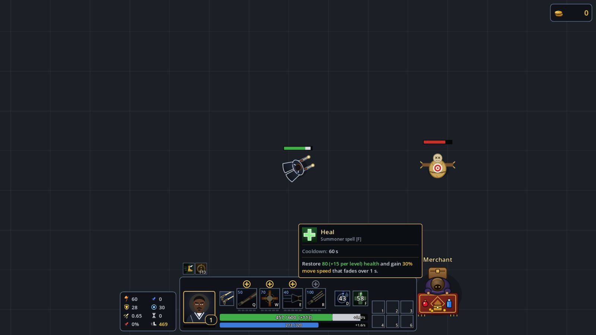 Heal's card; cooldowns on D and F | 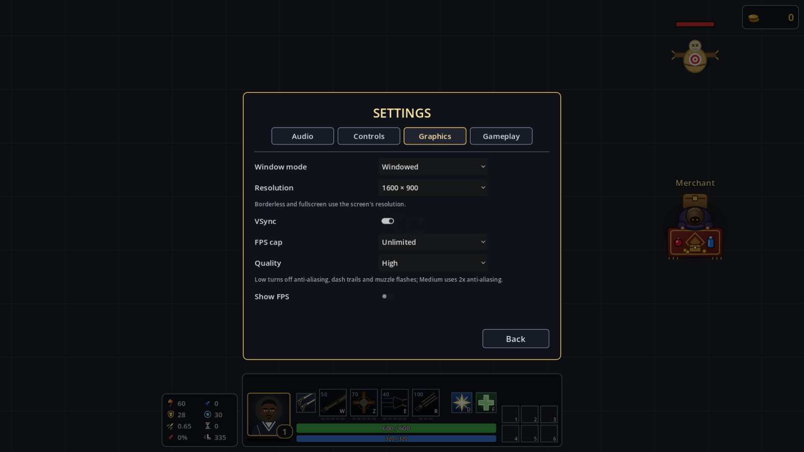 Graphics → Resolution |
| 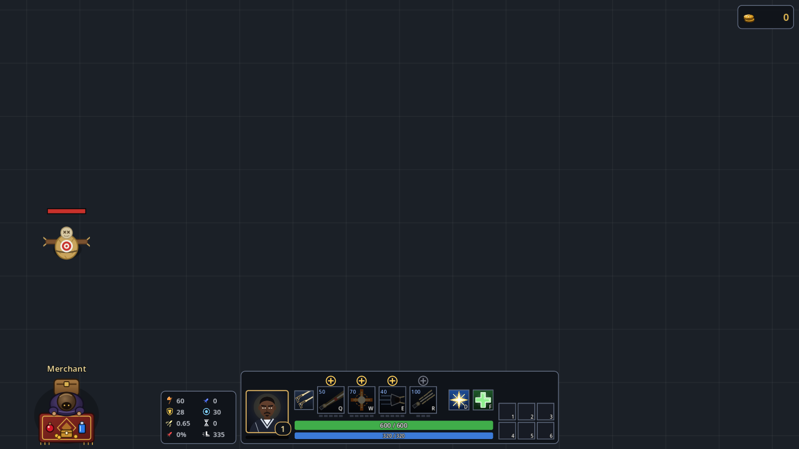 Free camera panned away | 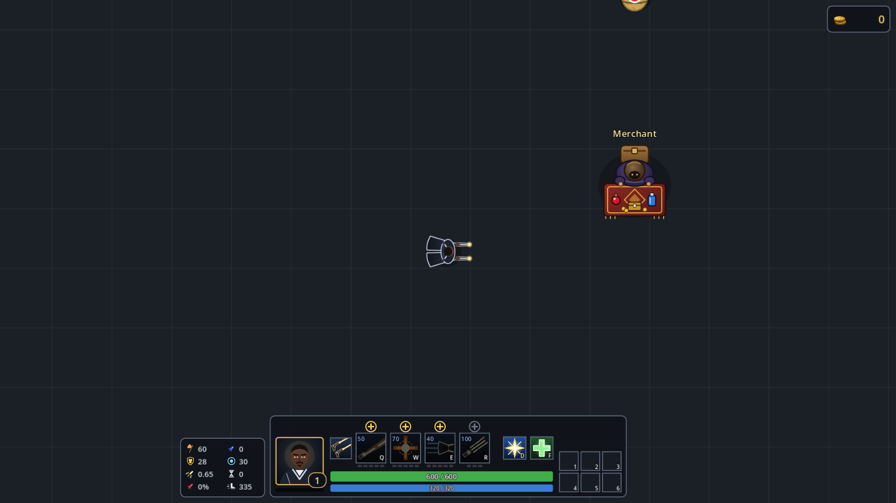 After Space |
| 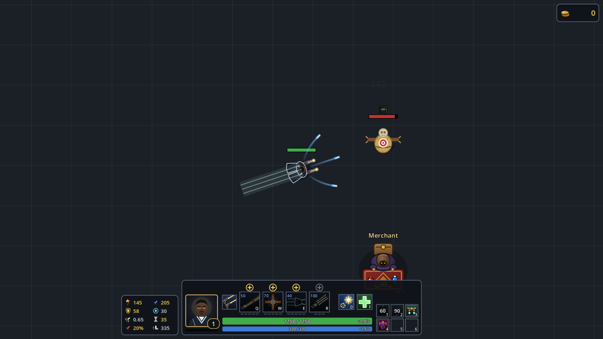 Follow-up: Galeforce's missiles curving onto the dummy, its green dash trail; Lucian's HP bar |  Follow-up: one regen cell, "+0.8/s" on the HP bar |
| 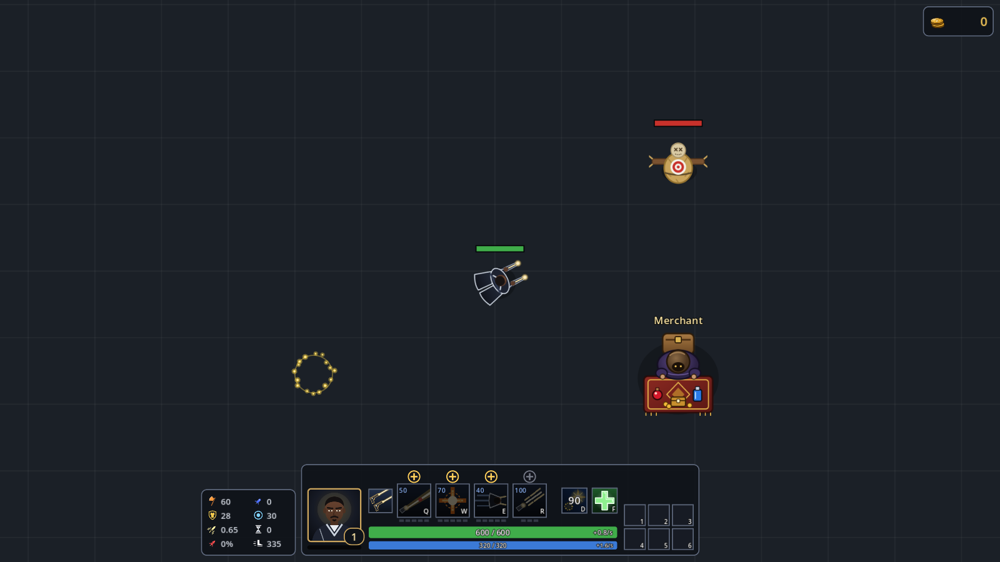 Follow-up: Flash's yellow sparks where Lucian stood, no trail | |

## Known limits

- **No Evolution Tree yet**, so every summoner spell and both slots are open, and every skill rank is bought. The locked grey "+" only shows if you lower `progress.bought` (the `skillbar` scenario does this).
- **Nothing hits Lucian**, so Barrier and tenacity have nothing to work on yet; Smite's elite essence bonus waits for elites.
- **Resolution applies to windowed mode only.** Fullscreen modes use the screen's size, and the game scales to fit as before.
- **One older test file** (`test_lucian_skills`, unchanged this phase) still leaves 4 shot nodes behind after its R tests. GUT only warns about it, and every test passes.

## Manual playtest checklist (for you)

1. Equip Statikk Shiv and attack the dummy: the Energized number rises by 9 per attack.
2. F3+Q → Items: the picker runs A → Z.
3. Equip Hextech Rocketbelt and use it toward the dummy from far away: the bolts fly about 900.
4. Use Gunblade, then tick **No cooldowns**: the slot's cooldown clears at once (same for D and F).
5. F3+Q → Lucian → Set level 2, rank Q: Q's "+" is grey until level 3, R's until level 6.
6. Pan the camera away with the mouse and press **Space**: it jumps back over Lucian and still pans freely.
7. **Ctrl + C** hides and shows the stats; **hold C** for the extra table; hover a stat for 1 s; hover an item for its stat icons.
8. Equip Rapid Firecannon, F3+Q → Items → Energize now: the blue ring appears and goes away when the shot lands.
9. Press **D** and **F** for each spell (swap them in F3+Q → Lucian). Cooldowns show on the HUD and keep running when you move a spell to the other key.
10. Cast R: Q and W turn grey. Cast Q: E turns grey for its cast.
11. ESC → Settings → Graphics → Resolution: the window resizes and centers; greyed out in fullscreen; kept after a restart.

## Feedback and suggestions

- **Waves and killable enemies are still the biggest gap.** Smite's elite bonus, E's max rank bonus and the merchant's break timing all wait for them.
- **Summoner numbers** are LoL-like placeholders (Flash 90 s is long for a wave game). They are constants at the top of `src/lucian/summoners/summoner_spells.gd`, and the cooldowns are in `data/summoners/*.tres`.
- **The stat descriptions** are short one-liners in `src/ui/stat_style.gd`; easy to reword.
