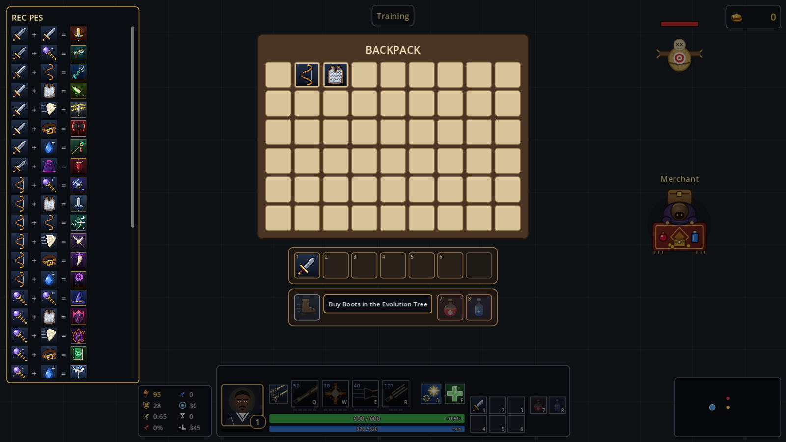
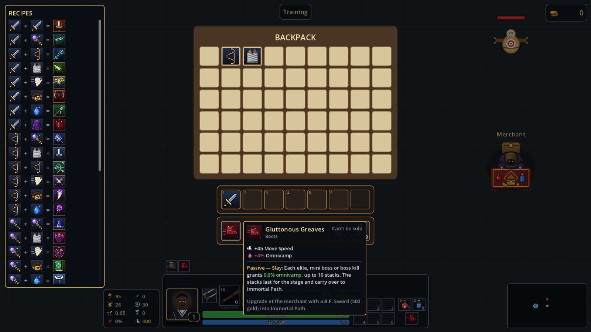
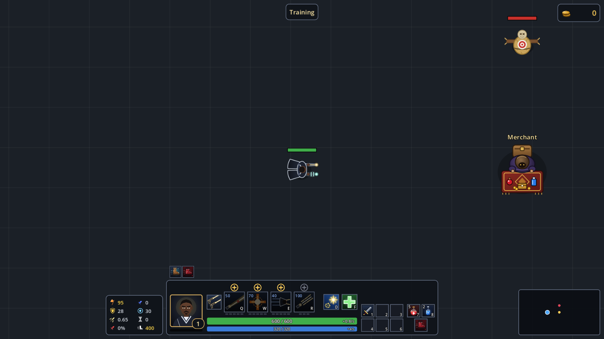
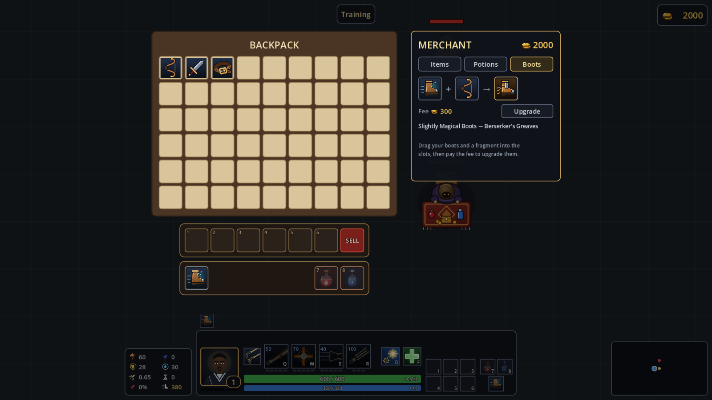
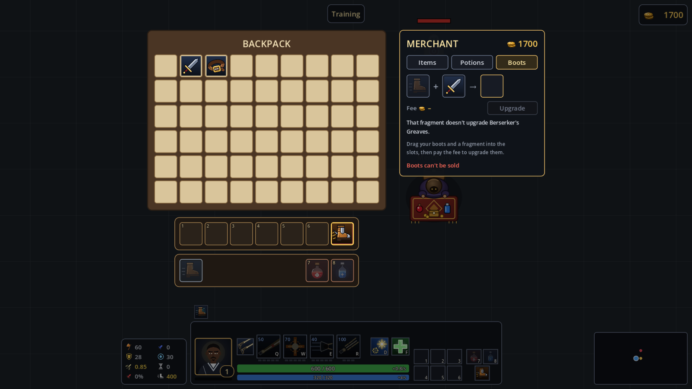
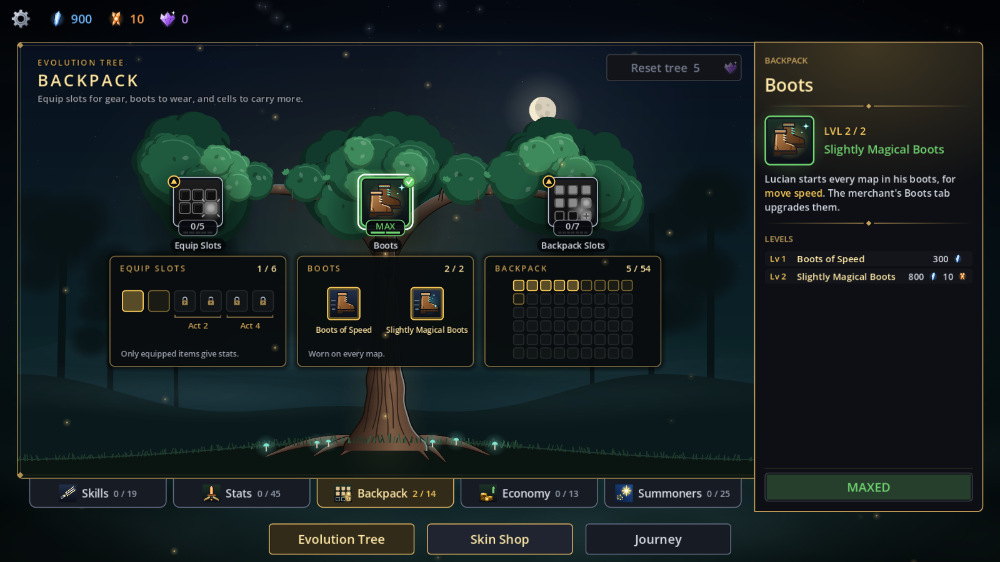
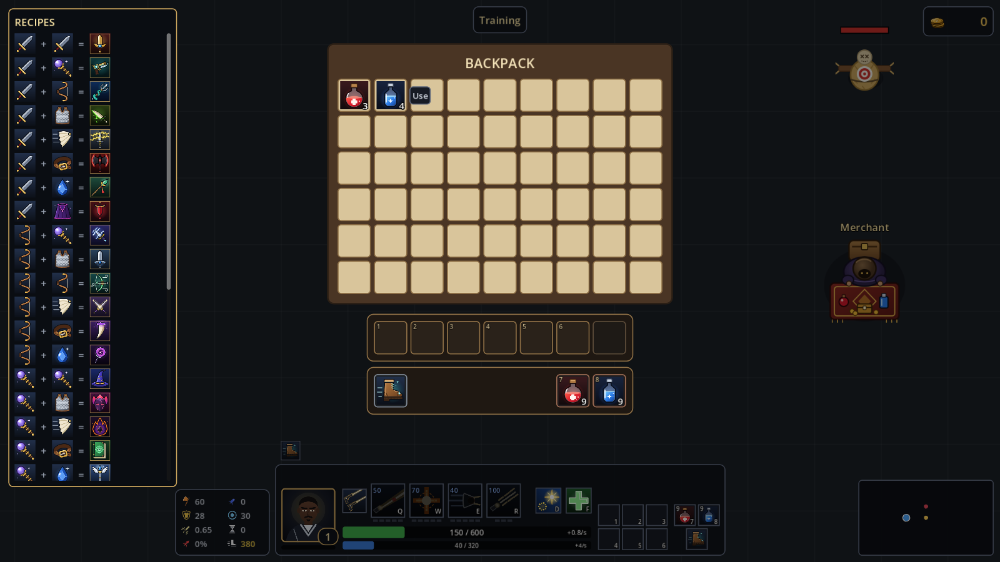
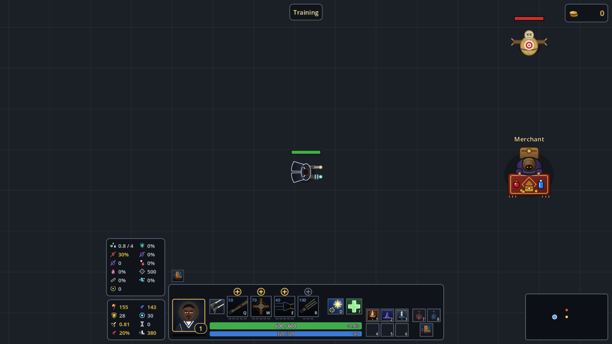

# V1.4 report: the boots system and the potion cells

**Date:** 2026-11-06 · **Version:** 1.4.0 · **Plan:** `docs/implementation/v1.4.md` · **Branch:** `v1.4`

## Summary

V1.4 adds two features from the plan:

- **Two potion cells** on keys 7 and 8. Potions no longer go in equip slots 1–6.
- **16 boots.**
  - **Tier 1** is bought once in the Evolution Tree and worn on every map.
  - **Tiers 2 and 3** are upgraded at a new **Boots** tab in the merchant, for a fragment and a gold fee.

Stats and passives follow LoL. Every step of the plan is built, and the full suite passes (see [Tests](#tests)). The plan's one open question was answered by you: the tier-3 boots **keep** their tier-2 effect (Chainlaced Crushers' tenacity, Armored Advance's Plating).

The branch was cut from V1.3. I replayed the plan commit onto V1.3.1, so V1.4 keeps the nine fixes.

## What is in it

| Part | What it does |
|---|---|
| Inventory | 63 cells: Health potion cell (60), Mana potion cell (61) and the boots cell (62) after the equip slots. They are never locked. Potions fill their cell first (9 at most), then the backpack. Equip slots refuse potions both ways, and boots never leave their cell. |
| Keys | `potion_hp` (7) and `potion_mp` (8), rebindable under ITEMS, with no cast mode. An empty cell does nothing, and nothing refills it. |
| Boots data | 16 `.tres` files in `data/items/boots`, with LoL 26.x stats, the passives' text, each tier-2/3 pair's fragment and fee, and 16 hand-made icons. |
| Evolution Tree | A **Boots** node on the Backpack page's trunk between the two plaques. Level 1 is Boots of Speed (300 blue); level 2 is Slightly Magical Boots (800 blue + 10 orange). It has its own plaque. 35 nodes, 116 levels. |
| Every map | Story stages, the tutorial, Training and Endless start in the boots bought. *Slightly Quicker* (+10 move speed) comes from the tree level, so it lasts through upgrades with no new save data. |
| Merchant | New **Boots** tab: `[boots] + [fragment] → [new boots]`, the fee and Upgrade. Its slots hold inventory indexes, so nothing is ever lost when the shop closes. Boots can't be sold: on the sell slot they read NO. |
| New rules | Slow resist, summoner spell haste and flat magic penetration, each with a stat line, an icon and a cell in the extra stats panel (11 cells). |
| Passives | Plating, Slay, Now and Forever, Noxian Fervor, Noxian Haste, and the Noxian Persistence / Endurance shields (`docs/items.md`, *What works in combat*). |
| UI | A gear strip under the equip strip (`[Boots] … [7][8]`) whose empty cells show what goes there, faded. A HUD gear column beside the item slots. Boots cards say "Can't be sold" and show the upgrade path. |
| Debug | A Boots picker on the Items tab. +HP / +MP fill the potion cells first. |

### Choices worth knowing

The plan left these open, so I picked:

- **Item costs:**
  - Boots have no buy cost. They are never bought or sold, and the merchant's fee is each pair's `upgrade_cost`.
  - A potion that restores both HP and mana would go in the Health cell. No such potion exists.
- **The Boots tab:**
  - Its fragment slot takes any fragment. With Giant's Belt (no boots line) the note says "That fragment doesn't upgrade …" and Upgrade stays off.
  - Dropping anything other than boots or a fragment into its slots says "Only boots go there" / "Only a fragment goes there".
- **Passives:**
  - *Noxian Fervor* uses Lucian's move speed stat, not buffs or slows.
  - *Now and Forever*'s ×1.04 applies after the other damage bonuses add up.
  - The Noxian shields also trigger on burn ticks of their damage type.
  - *Slightly Quicker* needs boots on. With none (only possible through the debug picker), it is off.
- **Debug picker:** an upgraded pair keeps the current Boots level (at least 1). The two tier-1 pairs set it to 1 or 2.
- **Bot:** it now buys Boots as a player would: level 1 after the first Backpack Slots level, level 2 with equip slot 3. So its numbers aren't directly comparable with V1.3's. It doesn't upgrade boots at the merchant.
- **Plaque text:** the Boots plaque's last line is "Worn on every map." The longer line ran past the plaque in the first screenshot.

## Tests

- **New tests: 62** (1742 → 1804), in two new files and the files the plan names.

  | File | What they check |
  |---|---|
  | `test_boots.gd` (new, 22) | The boots cell's rules, potion cells, keys; every legal upgrade and the wrong ones; the merchant's upgrade, fee, NO_GOLD, NOT_UPGRADABLE, NO_BOOTS, WRONG_CELL; boots can't be sold; the merchant and kills never give boots; the tree's level reaching story stages, the tutorial, a 1-1 replay, Training and Endless; Slightly Quicker through an upgrade (345 + 25 + 10) |
  | `test_boot_passives.gd` (new, 18) | Slow resist, summoner haste, flat pen on hits and on an enemy, Plating (not skills, not burns), tier-3 tenacity and Plating, Slay (stacking, cap, carry-over to Immortal Path), Now and Forever (damage, heals, shields), Fervor (AD and AP), Noxian Haste's 4 s lockout, both Noxian shields and their order |
  | `test_item_data_files.gd` | 16 boots, tier 1, each line's links and fees, LoL stats, passive names, Giant's Belt without a line |
  | `test_inventory.gd`, `test_potions.gd`, `test_shop.gd`, `test_lucian_cc.gd`, `test_lucian_controller.gd` | Potion cells first and their cap, no auto-refill, keys 7 and 8, an empty cell, a stun stopping them |
  | `test_shop_drag.gd` | The cells in index order with the sell slot last, boots refused by the sell slot and by any cell, the Boots tab end to end, its no-boots note, a potion dragged onto an equip slot |
  | `test_damage_calc.gd`, `test_tooltips.gd`, `test_tree_data_files.gd` | Flat pen after percent, never below 0; boots and potion cards; the Boots node |

- **Updated:** `test_inventory` (63 cells), `test_stats_panel` (11 cells), `test_tree_section` (35 views), `test_item_catalog` (Armored Advance sorts second), `item_fixtures` (a boots fixture).
- **Full suite on the final tree:** 1804 tests, all pass (689 s, headless). No script errors, and no warnings beyond the ones the save and settings tests cause on purpose.
- **Commits:** one per plan step. Only the final tree ran the full suite. The commits before step 9 (keys 7 and 8) still carry the old potion tests that put potions in equip slots; those tests change with the steps that need them.

## Other checks

- **Screenshots** (windowed, `tests/tools/screenshot.gd`; three new scenarios `gear`, `boots_shop`, `tree_boots`, and the old `potions`, `stats` and `main_tree_max` re-run): every "expect" line matched. One expectation in the new `boots_shop` scenario was wrong and is fixed (Giant's Belt does sit in the fragment slot).
- **Bots** (headless, skilled):
  - From a new save to 2-3: every stage cleared on the first try. It hadn't reached Boots in its buy order yet.
  - From 3-1 with 3000 blue and 40 orange: it bought Boots of Speed and played 3-1 and 3-2 in them. 3-1 cleared first try; 3-2 failed once to a burn and cleared on the second.
  - No script errors in either run.
- **Build:** exported with the "Windows Desktop" preset (exit 0).
  - **Smoke test:** the .exe ran for 20 s in a window, then headless until `--quit-after` (exit 0, no errors in its log).
  - **The zip:** `build/release/LucianTheLantern-v1.4.0-windows-x64.zip` is built locally. It isn't published.

## Not done

- **Playing by hand (the plan's verification step 3)** is yours. The checks to do:
  1. Buy Boots, then start Act 2.
  2. Buy potions and drink them with 7 and 8.
  3. Upgrade at the merchant.
  4. Try selling boots, putting a potion in slot 1, and using a wrong fragment.
  5. Check move speed in the stats panel.
  6. Check that Endless, Training and a 1-1 replay start in boots.

  The tests and screenshots cover each of these, but not in one played session.
- **No balance pass.** Boots make Lucian stronger from Act 1 on. The bot runs above only show that the game plays; they don't measure the change. Tuning would be a separate step with bot data, as for V1.3.
