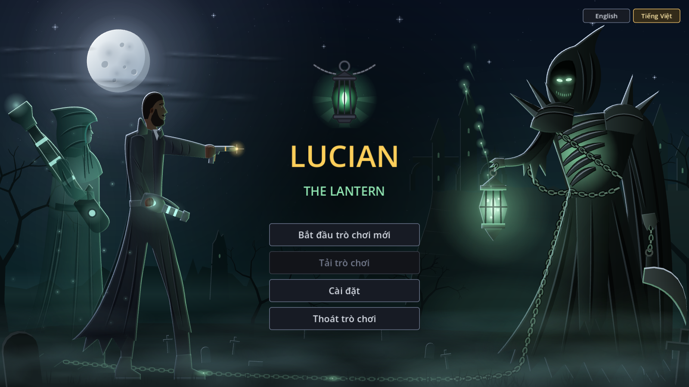
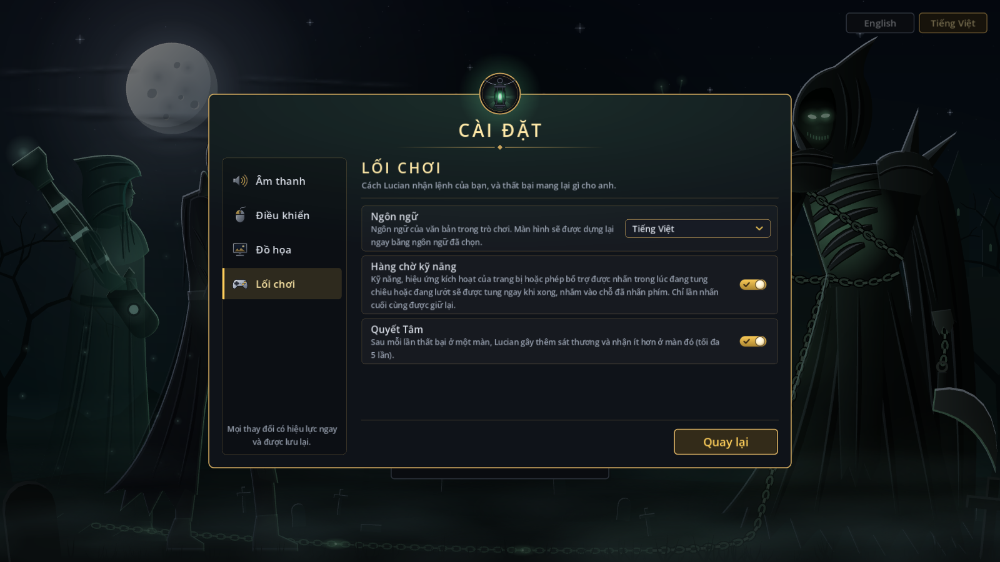
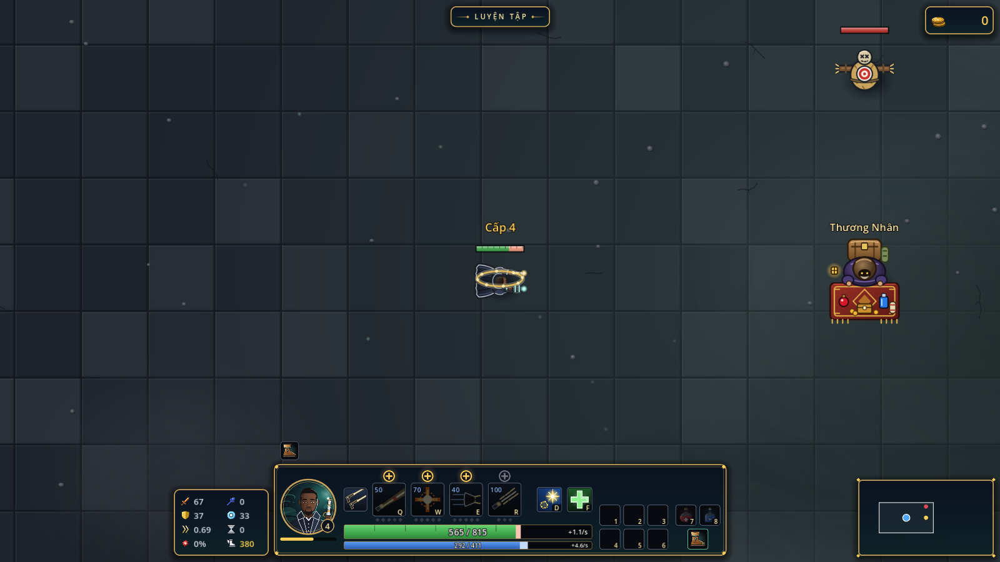
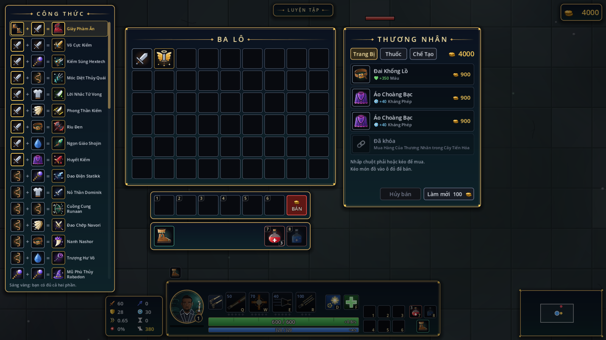
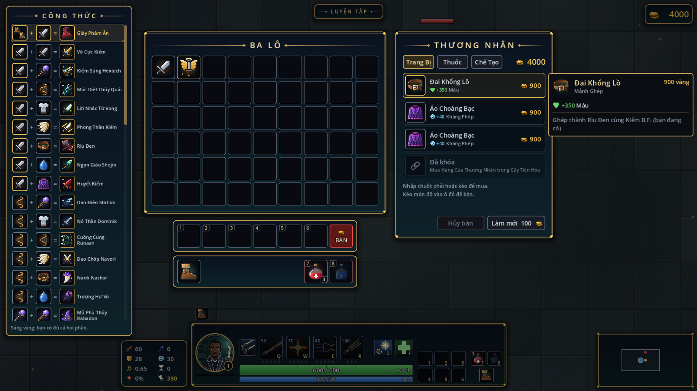
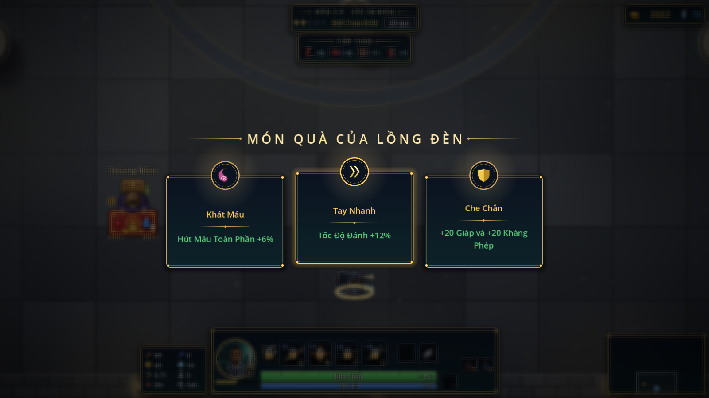
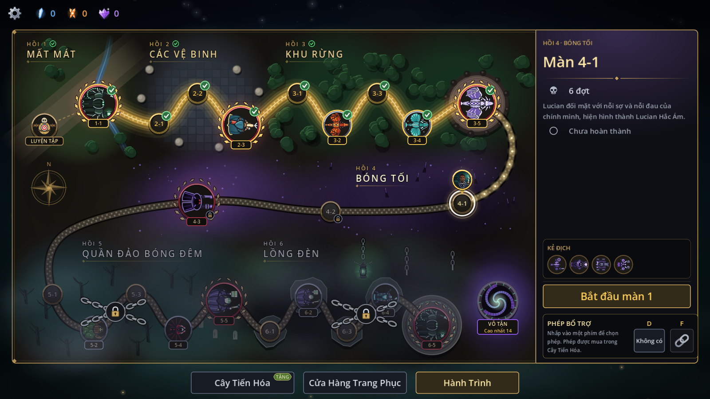
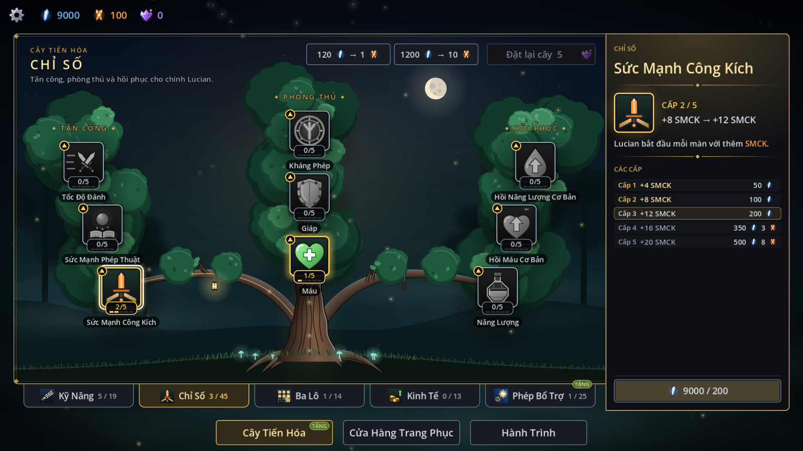
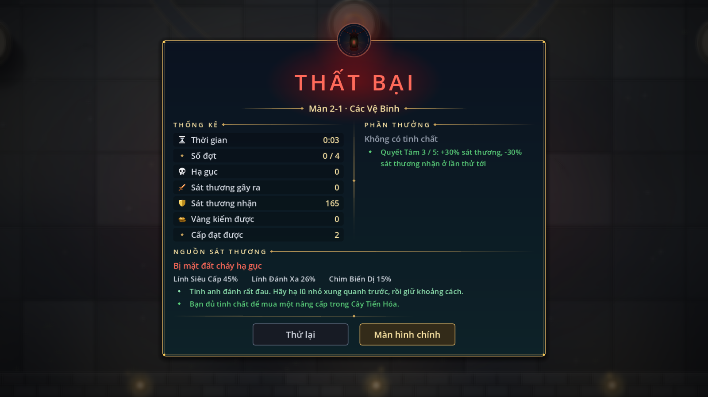
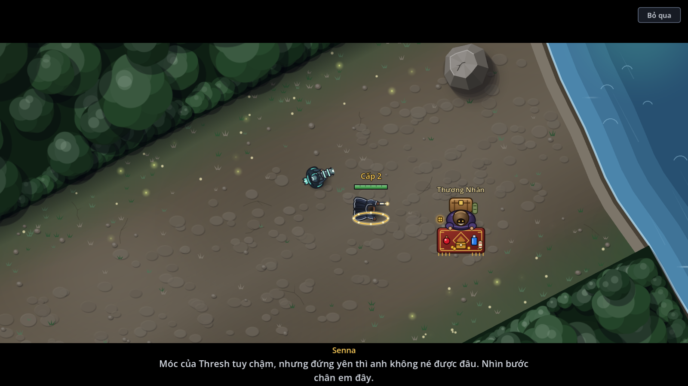

# V2.0.1 report: a language setting, English or Vietnamese

**Date:** 2026-11-13 · **Version:** 2.0.1 · **Plan:** `docs/implementation/v2.0.1.md` · **Branch:** `v2.0.1` (from `main`, `727f954`)

## Summary

V2.0.1 does what you asked on 2026-11-13: the game has a language setting with two choices, English and Vietnamese, and every text a player reads has a Vietnamese. It is 21 signed commits on `v2.0.1`. No rule, number or picture changed.

- **Choosing:** two buttons at the title screen's top right, **English** and **Tiếng Việt**, and a Language row first on Settings → Gameplay. The game starts in English.
- **Switching:** the title or the main screen is built again in the new language at once, with Settings still open on the same tab. During a stage the row is greyed out: a stage keeps the language it started in.
- **The Vietnamese:** 898 texts in five files. Names of items, skills, spells and stats follow the Vietnamese League of Legends client.
- **Tests:** the full suite passes, **2601 of 2601** (V2.0.0 had 2531). A test now fails if any text in the code or the data has no Vietnamese.
- **Checked on screen:** 223 screenshots in Vietnamese were read for English left over, text that no longer fits and broken letters. What was found is fixed.
- **Build:** exported, zipped and smoke-run in both languages.

## How it looks

| | |
|---|---|
|  |  |
|  |  |
|  |  |
|  |  |
|  |  |

## What was built

| Item | What it is |
|---|---|
| The setting | `language` in the settings file (`en` or `vi`), for every save slot. A file with an unknown code falls back to English. |
| The title's buttons | Each language named in itself, whatever the language in use, so a player who cannot read the screen still finds theirs. The one in use is lit gold. |
| The Settings row | First on the Gameplay tab. A note under it says the screen is built again at once; in a stage it says to change it on the title or the main screen. |
| The switch | The Game builds the title or the main screen again and opens Settings where it was. |
| `Lang.t()` | The one function every text goes through where it is shown: 538 calls in 86 scripts. English is the text in the code; Vietnamese is looked up by it. A text with no Vietnamese shows in English. |
| The files | `locale/vi/common.po` (222 names and shared words), `items.po` (167), `stage.po` (184), `main.po` (213), `shell.po` (112). gettext, the format translation tools read. |
| The glossary | `locale/glossary_vi.md`: 292 League names with where each Vietnamese came from. |
| The contract | `docs/translation.md`: the rules for code and for the Vietnamese, and the table of terms. |

## Choices worth knowing

- **A stage keeps its language.** Switching mid-stage would leave half the HUD in the old language until each piece next refreshed. Locking it there keeps every screen whole. Say so if you want it to switch mid-stage; it is more work, and each HUD piece would need its own refresh.
- **Left in English on purpose:** the game's name on the title ("LUCIAN", "THE LANTERN"), champions' names, key names and mouse labels (Space, LMB, M4), "FPS", "VSync", and the debug tables.
- **AD and AP read SMCK and SMPT** in Vietnamese.
- **Where the names come from.** 206 of the 292 names are the Vietnamese client's own wording, read from Riot's data files. 26 are what Vietnamese players and wikis call them and are not confirmed against the client: the minions (Lính Cận Chiến, Lính Đánh Xa, Lính Xe Pháo), the jungle monsters (Chim Biến Dị, Sói Hắc Ám, Quái Krug, Cóc Thành Tinh, Khổng Lồ Đá Xanh, Bụi Gai Đỏ Thành Tinh, Cua Kỳ Cục) and the dragons (Rồng Lửa, Rồng Nước, Rồng Ngàn Tuổi). 60 are the game's own things (the Lantern's gift, the Evolution Tree, the modifiers) and are translated plainly. You know the client better than the sources did: the list is one file, and a change there is one line in `common.po`.
- **Two client names repeat:** Noxian Endurance and Noxian Persistence are both "Sức Bền Noxus" in the client, and the Heal spell and nothing else is "Hồi Máu" (Health Regen is "Hồi Máu Cơ Bản").
- **The voice.** Senna speaks to Lucian as "anh" and "em"; Thresh says "ngươi" and "ta". Tips speak to the player as "bạn". Seconds are "s" in stat lines and "giây" in "mỗi giây".
- **Sentences were made whole.** Where the code joined a sentence from pieces (the boots' footer, potion texts, the Act 1 tips, the tree's reset question), it is one format now, because a sentence cannot be translated in pieces. The English reads exactly as before.
- **No new font.** The built-in font has every Vietnamese letter.

## How the Vietnamese was checked

1. **Names first.** One worker built the glossary against the client's data before anything was translated, so every translator used the same names.
2. **Four translators, one per part of the game**, each with the glossary and the contract.
3. **One reviewer read all 898 entries** against their English and changed 121: a wrong meaning (the gear menu called the title screen "the main screen"), one term per English term (save slot, rank, modifier, buff against effect), wording that read like English, dialogue that did not sound spoken, and texts too long for their place ("Bị trói chân" under the health bar became "Trói chân").
4. **223 screenshots of 69 scenarios in Vietnamese**, read by three workers. They found no broken letter and no English left by the game. What they did find, all fixed:
   - Senna's first lesson wrapped to two lines and its second line fell off the screen. A caption that wraps now starts higher on the bar; an English caption sits where it did.
   - The Journey's Resolve line ran off its panel and off the screen. It wraps now.
   - The Controls page's reset button touched the frame and its hint took three lines. Both texts are shorter.
   - "AD" stood in three Vietnamese texts; the Craft tab was "tab"; the Resolve line said "nhận vào" where the HUD says "sát thương nhận"; "DEFEATED" is "THẤT BẠI" as in the client, and "GAME OVER" has its own heading.
5. I looked at the title, Settings, the merchant, the defeat card and the three fixed places myself, in Vietnamese and in English.

## Tests

- **Full suite:** **2601 of 2601 passing** at `b58eb8b`, the last commit that changes code (docs and this report follow it). 143 scripts, 92,577 asserts, 944 s, no script errors and no leak warnings.
- **New: 70 tests** in six files.
  - The setting, the picker, the lock in a stage and the Game's rebuild.
  - The files: they load; none is missing from the project's list; no translation is empty, breaks its English's values or tags, or differs between two files.
  - Coverage: every text in `src/` (but the debug tables) and every data text has a Vietnamese or is listed as left in English. A new English text without one fails the suite.
  - Each part's screens are built with a probe that marks whatever goes through `Lang.t()`: a text on screen with plain letters left is a text someone forgot.
- **No existing test was changed.** They assert the English and run in English.
- **Reviews:** the reviewer of the Vietnamese also read the code the four translators changed for texts the scan cannot see (drawn text, joined words, hover texts) and found none. No second reader reviewed the groundwork (`lang.gd`, the picker, the rebuild); its 14 tests cover it.

## Other checks

- **Build:** exported headless at `7590b38` to `build/windows/LucianTheLantern.exe` (exit 0, no errors). The exe holds version 2.0.1, the save folder `lucian_the_lantern` and the five `.po` files whole.
- **Zip:** `build/release/LucianTheLantern-v2.0.1-windows-x64.zip`, 41,044,160 bytes, SHA-256 `d4e7943cdb6302df94b99c6ff37c15cc7c5620641e28ff3f97a5a4ef44be1026`, in the same layout as before. `README.txt` says 2.0.1 and names the two languages.
- **Smoke runs:** the exe from the zip ran headless to `--quit-after 600` with a new settings file (exit 0, no errors), and the exported exe ran the same way with the language set to Vietnamese (exit 0, no errors). Both used a scratch folder for their data, not your saves.
- **Docs:** the plan, `docs/translation.md`, the UI doc's Settings and title sections and the README.

## Not done

- **A stage cannot change language** while it is played.
- **Nobody played it in Vietnamese by hand.** The checks are tests and screenshots.
- **Tight spots that still fit but have no room left:** the Craft button's "Không có công thức", the result card's "Về màn hình tiêu đề", the section bar's "Cửa Hàng Trang Phục", and two Endless modifier cards whose text wraps to two lines where the English takes one.
- **The 26 "likely" names** are not confirmed against the client.
- **Two things the screenshots flagged that are the same in English** and were left: the difficulty hover text covers the button beside it, and "Start stage 2" on stage 3-2 names only the stage's number in its act.
- **The screenshot tool's `act3_result` scenario** fails in both languages: it expects the drake after three waves, and 3-2 has had six since V2.0.
